# 星遇同频 · 开放接口

**[📖 在线交互式 API 文档 (API Wiki)](https://docs.vrcc.cc/)** · **[OpenAPI 规范 (`openapi.yaml`)](openapi.yaml)** · **[最小示例 (`examples/client.mjs`)](examples/client.mjs)** · **[登录示例 (`examples/login-site.mjs`)](examples/login-site.mjs)** · **[更新记录 (`CHANGELOG.md`)](CHANGELOG.md)**

---

[星遇同频](https://vrcc.cc/match/) 的开放接口，地址都在 `https://vrcc.cc/api/v1/` 下面。接口只给网页上本来就能看到的东西，分三类：

| 类别 | 是否需要令牌 | 适用场景 | 数据范围 |
| --- | --- | --- | --- |
| **开放数据** | 不用登录（仅需 `client` 标识） | VRChat 世界里的地图榜组件、社区网站、机器人 | 和公开的 [地图榜页面](https://vrcc.cc/maps/) 一样：过审地图、平均分、几人评分、名次、性能轻重（不含谁打的分和短评） |
| **玩家自己的** | 需要令牌（`Authorization: Bearer`），玩家用**设备授权**同意后拿到 | 桌面客户端（如官方 [VRCX 脚本](https://github.com/vrcc-cc/xingyu-tongpin-vrcx)、VRCX 分支、Tauri 工具） | 只给这位玩家本人，范围和网页上一样：收提醒、看星轨相交和互相连上的星、给所在地图打分 |
| **用星遇同频登录** | 网站自己登记拿 `client_id`，玩家点「继续」后拿到令牌 | 想让玩家「用星遇同频登录」的网站（像 Google 登录那样） | 只给一个这个网站专用的编号、星号、验证过的 VRChat 名字和 ID |

## 目录

- [接口速查表](#接口速查表)
- [使用要求（必读）](#使用要求)
- [快速开始与接入流程](#快速开始与接入流程)
- [请求规范与通用错误](#请求规范与通用错误)
- [开放数据：地图榜](#开放数据地图榜)
- [玩家自己的接口](#玩家自己的接口)（[设备授权](#设备授权post-apiv1devicecode)）
- [用星遇同频登录（网站）](#用星遇同频登录网站)
- [频率限制](#频率限制)
- [最小示例](#示例)
- [授权与旧接口](#授权)

---

## 接口速查表

| 分类 | 方法 | 路径 | 认证 | 说明 |
| --- | --- | --- | --- | --- |
| **地图榜** | `GET` | [`/api/v1/boards/maps`](#排行get-apiv1boardsmapslimit20) | `client` | 地图榜总榜排行（满 5 人评分，按名次排，`limit` 1–100） |
| **地图榜** | `GET` | [`/api/v1/maps`](#查几张地图get-apiv1mapsidswrld_wrld_) | `client` | 按世界 ID 批量查几张地图（最多 20 张，只返回在榜上的） |
| **地图榜** | `GET` | [`/api/v1/maps/{world}`](#查一张地图get-apiv1mapsworld) | `client` | 查单张地图在地图榜上的数据 |
| **连接** | `POST` | [`/api/v1/device/code`](#设备授权post-apiv1devicecode) | `client` | 设备授权第一步：拿一个给玩家看的码和同意链接（推荐） |
| **连接** | `POST` | [`/api/v1/device/token`](#换令牌post-apiv1devicetoken) | `client` | 设备授权第二步：每 5 秒问一次，玩家同意后拿到 48 位令牌 |
| **连接** | `POST` | [`/api/v1/connect`](#连接码旧方式post-apiv1connect) | `client` | 旧方式：用玩家给的 8 位连接码换令牌（还能用） |
| **连接** | `POST` | [`/api/v1/disconnect`](#断开post-apiv1disconnect) | `client` + `Bearer` | 断开这个客户端，令牌立刻失效 |
| **玩家本人** | `GET` | [`/api/v1/me/notifications`](#提醒get-apiv1menotificationssincelast) | `client` + `Bearer` | 轮询新提醒与星轨相交未读红点（建议每 60 秒一次） |
| **玩家本人** | `GET` | [`/api/v1/me/notifications/recent`](#最近的提醒get-apiv1menotificationsrecentmark1) | `client` + `Bearer` | 最近一天的最后 5 条提醒（带页面跳转路径，支持标已读） |
| **玩家本人** | `GET` | [`/api/v1/me/crossings`](#星轨相交get-apiv1mecrossingsmark1) | `client` + `Bearer` | 「星轨相交」擦肩列表（支持标已读消红点） |
| **玩家本人** | `GET` | [`/api/v1/me/mutuals`](#互相连上get-apiv1memutuals) | `client` + `Bearer` | 「互相连上」的星列表（含对方的 VRChat 名字与可选用户 ID） |
| **玩家本人** | `GET` | [`/api/v1/me/maps/{world}`](#所在的地图get-apiv1memapsworld) | `client` + `Bearer` | 玩家当前所在地图在榜上的状态、本人评分与短评 |
| **玩家本人** | `POST` | [`/api/v1/me/maps/{world}/rating`](#打分post-apiv1memapsworldrating) | `client` + `Bearer` | 给当前所在的地图打分（1–10 分）及写短评（最多 30 字） |
| **登录** | `GET` | [`https://vrcc.cc/oauth/authorize`](#第一步把玩家送到星遇同频) | 浏览器跳转 | 用星遇同频登录：把玩家送过来，同意后带 `code` 回到你的网站 |
| **登录** | `POST` | [`/api/v1/oauth/token`](#第二步换令牌-post-apiv1oauthtoken) | `client_id` + 密钥或 PKCE | 用 `code` 换令牌和玩家信息 |
| **登录** | `GET` | [`/api/v1/oauth/userinfo`](#第三步再查一次玩家-get-apiv1oauthuserinfo) | `Bearer` | 再查一次这位玩家（玩家断开后返回 `401`） |

> 💡 想要在线调试请求或复制各语言代码（cURL / JS / Python / Rust / C#），请直接打开 **[在线交互式 API 文档 (API Wiki)](https://docs.vrcc.cc/)**。

---

## 使用要求

用这套接口的客户端、组件和程序，都要做到下面这些。做不到的，我们会停用它。

### 所有调用方通用要求

1. **先登记。** 在本仓库 [开一个 Issue](https://github.com/vrcc-cc/xingyu-tongpin-api/issues/new?title=%E7%99%BB%E8%AE%B0%E5%AE%A2%E6%88%B7%E7%AB%AF%EF%BC%9A)，标题写「登记客户端」，写清：
   - 叫什么名字
   - 你给它定的 `client` 标识
   - 源码或 VRChat 世界在哪
   - 用了哪些接口、拿来做什么
   - 怎么联系你
   
   我们核对后把标识加进名单，才能正式使用。**开发、自测时用 `dev-` 开头的标识**（比如 `dev-mywidget`）；正式发布前必须登记。

   只做「用星遇同频登录」的网站不用开 Issue，在网页上自己登记，见「[用星遇同频登录](#用星遇同频登录网站)」。
2. **每个请求都带 `client`。** 用登记过的标识，不冒充别人。
3. **守频率。** 见下面「[频率限制](#频率限制)」；收到 `429` 就等一分钟再试。开放数据变得很慢，取一次用一阵，不要每秒都问。
4. **不绕过检查。** 发现安全问题，在本仓库的 Security 页私下报告，不要开公开 Issue。

### 用到「玩家自己的接口」还要做到

5. **源码公开。** 玩家要能看到你的客户端拿令牌做了什么。
6. **令牌只发给 `vrcc.cc`。** 设备码、连接码和令牌只存在玩家自己的电脑上，只发往 `https://vrcc.cc/api/v1/`，不经过你或任何第三方的服务器。
7. **数据只给这位玩家看。** 不转存、不上传、不汇总、不分享，不拿来做统计、排行或别的玩家看得到的东西。**互相连上的人的 VRChat 名字尤其如此。**
8. **打分只在玩家自己点的时候发。** 不自动打分，不批量打分。
9. **写明是第三方。** 界面上说清这是第三方客户端，不是星遇同频官方；连接、断开都由玩家自己操作，随时能断开。

### 做「用星遇同频登录」还要做到

10. **密钥只放在你的服务器上。** `client_secret` 不进网页、不进 App、不进仓库。只有前端、没有服务器的网站不用密钥，用 PKCE。
11. **每次都核对 `state`。** 回来的 `state` 和你发出去的不一样，就不要换令牌。
12. **用 `sub` 认人。** 账号用 `sub` 对应，不用星号或 VRChat 名字（名字会改，星号可能没有）。
13. **说清拿数据做什么。** 在你的网站上写明拿到的星号、VRChat 名字和 ID 用来做什么。
14. **不装成官方。** 网站名称和页面不要让人以为是星遇同频官方的；名字里带「星遇同频」「VRCC」「VRChat」「官方」「管理员」的登记不了。

> [!IMPORTANT]
> 我们可以随时停用某个标识或网站，接口也可能调整；要改的地方会提前写在本仓库的 [CHANGELOG](CHANGELOG.md)。设备授权时玩家先看到客户端的名字再点同意；用旧的连接码连上时，星遇同频会发一条站内通知，写明是哪个客户端。网页「我的资料 → 第三方客户端」列出玩家连着的所有客户端和登录过的网站，每个都能单独断开。

---

## 快速开始与接入流程

### 场景一：拉取开放数据（地图榜）

开放数据无需玩家登录，只要在请求头带 `X-Client`（或在网址里带 `?client=`）：

```bash
curl -H "X-Client: dev-example" "https://vrcc.cc/api/v1/boards/maps?limit=10"
```

### 场景二：在 VRChat 世界里做地图榜组件（Udon）

VRChat 世界里的 Udon 脚本发不了自定义请求头，可以把标识放在网址的 `?client=` 参数里：

```
https://vrcc.cc/api/v1/boards/maps?limit=10&client=dev-mywidget
```

- **拉取数据**：Udon 用 `VRCStringDownloader` 读文字，回答用 `VRCJson` 解析；封面图用 `VRCImageDownloader` 读 `img`。
- **允许不受信任的网址**：`vrcc.cc` 不在 VRChat 默认信任的域名里，玩家要在 VRChat 设置里打开「**允许不受信任的网址**」（Allow Untrusted URLs）才能读到，请在世界里写一句提示。
- **冷却限制**：VRChat 限制每个世界 5 秒最多下载一次。进世界时取一次就够，榜单最多 5 分钟才更新一次。
- **数据署名**：请在世界里注明「**数据来自星遇同频地图榜（vrcc.cc）**」。

### 场景三：适配桌面客户端（设备授权与轮询生命周期）

推荐用**设备授权**（和电视上登录视频网站一样）：客户端拿一个码，玩家在浏览器里看到客户端的名字，点同意，客户端就拿到令牌。玩家不用复制任何东西。

1. **拿码**：`POST /device/code`，得到 `user_code`（如 `ABCD-2345`）、`verification_uri_complete` 和 `device_code`。
2. **给玩家看**：显示 `user_code`，并在浏览器里打开 `verification_uri_complete`（码已经在链接里）。玩家也可以自己去「我的资料 → 第三方客户端」输入码。
3. **等同意**：每 `interval` 秒（5 秒）`POST /device/token`。等的时候回答 `authorization_pending`，接着等；`access_denied` 是玩家不同意，`expired_token` 是过期了（10 分钟），都停下来，让玩家重新开始。
4. **存令牌**：拿到 `access_token` 后存在玩家本机。它只给一次，之后再问就是 `expired_token`。
5. **用令牌**：之后的请求都带 `Authorization: Bearer <access_token>`。
6. **失效了就重来**：收到 `404 gone`，停下轮询，回到第 1 步。

```mermaid
sequenceDiagram
    autonumber
    actor Player as 玩家
    participant Web as 星遇同频网页<br/>(vrcc.cc/match)
    participant App as 你的客户端<br/>(X-Client: xxx)
    participant API as 星遇同频 API<br/>(/api/v1)

    App->>API: POST /device/code
    API-->>App: user_code「ABCD-2345」、verification_uri_complete、device_code、interval 5
    App->>Player: 显示 ABCD-2345，并打开 verification_uri_complete
    Player->>Web: 在浏览器里看到客户端名字和它能做什么
    loop 每 interval 秒（5 秒），最多 10 分钟
        App->>API: POST /device/token { "device_code": "…" }
        API-->>App: 400 { "error": "authorization_pending" }
    end
    Player->>Web: 点「同意」
    App->>API: POST /device/token { "device_code": "…" }
    API-->>App: { "access_token": "…", "token_type": "Bearer", "me": {…} }（只给这一次）
    Note over App: 将 access_token 保存在玩家本机

    rect rgb(15, 20, 32)
        Note over App,API: VRChat 运行期间：每分钟轮询提醒
        App->>API: GET /me/notifications (首次不带 since)
        API-->>App: { "last": 1042, "items": [], "every": 60, "dot": 2 }
        loop 按返回的 every 秒数（如 60 秒）等待
            App->>API: GET /me/notifications?since=1042
            API-->>App: { "last": 1043, "items": [...], "every": 60, "dot": 2 }
        end
    end

    opt 玩家打开面板或切地图时按需请求
        App->>API: GET /me/crossings | /me/mutuals | /me/maps/{world}
        App->>API: POST /me/maps/{world}/rating (仅当玩家主动点击打分时)
    end

    Player->>App: 点击「断开连接」
    App->>API: POST /disconnect
    API-->>App: { "ok": true }（令牌立刻失效）
```



> [!WARNING]
> **每个客户端有自己的授权。** 你的客户端连上，不会顶掉玩家 VRCX 脚本里的连接，也不影响别的客户端。但同一个客户端、同一位玩家只有一个授权：再授权一次，这个客户端之前的令牌就失效了。每位玩家最多 10 个（第三方客户端和登录过的网站一起算），多了会删掉最久没用的。玩家在「我的资料 → 第三方客户端」能看到每一个，也能单独断开。当轮询或请求收到 `404`（`{"error": "gone"}`）时，说明令牌已失效，请立即停止轮询并让玩家重新授权。

旧的连接码方式（玩家在网页上拿 8 位码，输进你的客户端，客户端调 `POST /connect`）还能用，见「[连接码（旧方式）](#连接码旧方式post-apiv1connect)」。新客户端请用设备授权。

### 场景四：在你的网站上加「用星遇同频登录」

和「用 Google 登录」一样：玩家点你网站上的按钮，跳到星遇同频点「继续」，带着一个 `code` 回到你的网站；你的服务器用 `code` 换到玩家的编号 `sub`、星号和验证过的 VRChat 账号。

1. 在「我的资料 → 第三方客户端 → 开发者 → 我登记的网站」登记，拿到 `client_id` 和 `client_secret`。
2. 把玩家送到 `https://vrcc.cc/oauth/authorize?…`，带上 `state` 和 PKCE。
3. 回到你的回调地址后，核对 `state`，用 `code` 调 `POST /api/v1/oauth/token`。
4. 用 `user.sub` 找到或建立你网站上的账号。

详细的见「[用星遇同频登录（网站）](#用星遇同频登录网站)」，示例见 [`examples/login-site.mjs`](examples/login-site.mjs)。

---

## 请求规范与通用错误

- **基础地址**：`https://vrcc.cc/api/v1/` 加下面的路径。
- **客户端标识**：请求头 `X-Client: <标识>`。发不了请求头的（比如 VRChat 世界里的 Udon），在开放数据接口放在网址里：`?client=<标识>`。`oauth/` 下面的两个接口不用 `X-Client`，用网站的 `client_id`。
- **玩家自己的接口**：请求头 `Authorization: Bearer <令牌>`。**令牌绝不能放进网址。**
- **请求与响应格式**：`POST` 的正文是 JSON（最大 2 KB；`oauth/token` 也收表单）；所有回答都是 JSON。出错时 HTTP 状态码不是 `2xx`，正文是 `{"error": "…"}`。

### 通用错误码

| HTTP 状态 | `error` | 意思与处理方式 |
| :---: | --- | --- |
| `403` | `client_missing` | 请求没带 `client` 标识 |
| `403` | `client_unknown` | `client` 不在登记白名单里，也不是 `dev-` 开头 |
| `403` | `client_off` | 这个 `client` 标识已被停用 |
| `429` | `too_many` | 问得太快或今天次数用完，等至少一分钟后再试 |
| `401` | `token` | 玩家自己的接口没带令牌，或令牌格式不对 |
| `404` | `gone` | **令牌失效**（玩家断开了、同一个客户端又授权了一次、星被删除）：停下轮询，让玩家重新授权 |
| `404` | `not_found` | 没有这个接口，或查询的地图不在榜上 |
| `400` | `bad_request` | 请求参数或 JSON 格式不对 |
| `413` | `too_large` | `POST` 正文超过 2 KB |
| `400` | `authorization_pending` | 设备授权：玩家还没点同意，过 `interval` 秒再问 |
| `400` | `access_denied` | 设备授权：玩家点了不同意 |
| `400` | `expired_token` | 设备授权：码过期了（10 分钟）、已经换过令牌、不是这个客户端的，或没有这个码 |
| `400` / `401` | `invalid_request`、`invalid_client`、`invalid_grant` 等 | 用星遇同频登录的错误，见「[换令牌](#第二步换令牌-post-apiv1oauthtoken)」 |
| `401` | `invalid_token` | 用星遇同频登录：玩家断开了这个网站，或网站被停用 |

### 桌面客户端页面的跨域（CORS）说明

- **从浏览器/WebView 页面里直接发请求**的客户端（比如用 Tauri 做的）：只有以下 `Origin` 来源能读到回答：
  - `tauri://localhost`
  - `http://tauri.localhost`、`https://tauri.localhost`
  - `null`（本地文件页面 `file://`）
  - `http://localhost`、`http://127.0.0.1`（本地开发时）
  - 普通网站网页无法跨域调用。
- **从程序后端或脚本直接发请求**（Rust、Node.js、Python、C# 等）：不受浏览器跨域限制。
- **`oauth/token` 和 `oauth/userinfo`**：任何网站都能跨域调用（`Access-Control-Allow-Origin: *`），只有前端的网站可以直接在浏览器里用 PKCE 换令牌。

完整的字段定义和类型约束见 [`openapi.yaml`](openapi.yaml) 或 [在线交互式 API 文档](https://docs.vrcc.cc/)。

---

## 开放数据：地图榜

数据和 [vrcc.cc/maps/](https://vrcc.cc/maps/) 一样：通过审核的地图、平均分、几人评分、名次。不给谁打了分，也不给短评。服务器边缘缓存最多 5 分钟更新一次。

### 排行：`GET /api/v1/boards/maps?limit=20`

返回**满 5 人评分**的地图，按总榜名次排，`limit` 取值 `1–100`（默认 `20`）。

```json
{
  "board": "maps",
  "min": 5,
  "at": 1792830000000,
  "maps": [
    {
      "world": "wrld_…",
      "name": "地图名",
      "author": "作者",
      "avg": 9.1,
      "raters": 9,
      "rank": 1,
      "weight": "light",
      "page": "https://vrcc.cc/maps/wrld_…",
      "img": "https://vrcc.cc/maps/wrld_….jpg"
    }
  ]
}
```

| 字段 | 类型 | 说明 |
| --- | --- | --- |
| `board` | `string` | 固定为 `"maps"` |
| `min` | `integer` | 上总榜最少需要几人评分（当前为 `5`） |
| `at` | `integer` | 这份榜单快照生成的时间（毫秒时间戳） |
| `maps[].world` | `string` | VRChat 世界 ID（`wrld_…`） |
| `maps[].name` | `string` | 地图名 |
| `maps[].author` | `string \| null` | 地图作者 |
| `maps[].avg` | `number \| null` | 1–10 分的平均分（保留一位小数） |
| `maps[].raters` | `integer` | 几人评分 |
| `maps[].rank` | `integer \| null` | 总榜名次（不满 5 人评分时为 `null`） |
| `maps[].weight` | `string \| null` | 多小咕实测的轻重：`light` 轻量、`mid` 中等、`heavy` 较重，没测过是 `null` |
| `maps[].page` | `string` | 地图在星遇同频地图榜上的详情页网址 |
| `maps[].img` | `string \| null` | 封面图网址 |

### 查几张地图：`GET /api/v1/maps?ids=wrld_…,wrld_…`

- `ids`：逗号分隔的地图 ID，**一次最多 20 张**（超过 20 张或格式不对返回 `400 bad_request`）。
- 回答 `{"maps": […], "at": 1792830000000}`，只包含在榜上的地图，单张地图字段同上。

### 查一张地图：`GET /api/v1/maps/{world}`

- 回答 `{"map": {…}, "at": 1792830000000}`，字段同上。
- 如果地图不在榜上或未通过审核，返回 `404`（`{"error": "not_found"}`）。

---

## 玩家自己的接口

以下接口都必须在请求头里带 `X-Client: <标识>`；除了 `/device/code`、`/device/token`、`/connect`，还要带 `Authorization: Bearer <令牌>`。

### 设备授权：`POST /api/v1/device/code`

拿令牌的推荐方式。不用正文，只带 `X-Client`。

**成功回答（`200`）：**

```json
{
  "device_code": "9f2c4e1a7b3d5f6081726354a0b1c2d3e4f5a6b7c8d9e0f1",
  "user_code": "ABCD-2345",
  "verification_uri": "https://vrcc.cc/match/?connect",
  "verification_uri_complete": "https://vrcc.cc/match/?connect=ABCD2345",
  "expires_in": 600,
  "interval": 5
}
```

| 字段 | 说明 |
| --- | --- |
| `device_code` | 48 位十六进制，客户端自己留着换令牌用，**不给玩家看** |
| `user_code` | 给玩家看的码，玩家也可以在「我的资料 → 第三方客户端」手动输入 |
| `verification_uri` | 玩家手动输码的页面 |
| `verification_uri_complete` | 带着码的链接，在浏览器里打开就行，玩家不用输码 |
| `expires_in` | 多少秒内有效（`600`，10 分钟） |
| `interval` | 多少秒问一次 `/device/token`（`5`） |

玩家要先登录星遇同频。打开链接后，玩家看到客户端的名字（没登记的 `dev-` 标识会写「（测试中）」和「还没登记，只在测试」）和它能做什么：收提醒、看星轨相交和互相连上的星、给去过的地图打分，然后点「同意」或「不同意」。

- **错误状态**：`429 too_many`：这个网络今天拿的码太多（每天最多 30 个）。

---

### 换令牌：`POST /api/v1/device/token`

拿到码以后，每 `interval` 秒问一次，**不要更快**。带的 `X-Client` 要和拿码时一样。

**请求正文：**

```json
{ "device_code": "9f2c4e1a7b3d5f6081726354a0b1c2d3e4f5a6b7c8d9e0f1" }
```

**玩家同意后（`200`，只给这一次）：**

```json
{
  "access_token": "a1b2c3d4e5f60123456789abcdef0123456789abcdef0123",
  "token_type": "Bearer",
  "me": {
    "star": 128,
    "vrc": "玩家的 VRChat 名字"
  }
}
```

- `access_token`：48 位十六进制令牌，之后的个人接口都放在 `Authorization: Bearer <access_token>` 里。
- `me`：和「连接码」那里的 `me` 一样。

**还没拿到时（都是 `400`）：**

| `error` | 意思 | 客户端怎么做 |
| --- | --- | --- |
| `authorization_pending` | 玩家还没点 | 过 `interval` 秒再问 |
| `access_denied` | 玩家点了不同意 | 停下，告诉玩家没连上 |
| `expired_token` | 过期了（10 分钟）、已经换过令牌、不是这个客户端拿的码，或没有这个码 | 停下，要连就重新拿码 |

---

### 连接码（旧方式）：`POST /api/v1/connect`

旧的方式，**还能用**，新客户端请用上面的设备授权。用连接码连上的，也是这个客户端自己的授权，不会顶掉 VRCX 脚本。

玩家在星遇同频网页「我的资料 → 在 VRCX 里提醒」拿到连接码（8 位，10 分钟内有效，只能用一次），发给此接口换取**令牌**（48 位十六进制）。

**请求正文：**

```json
{ "code": "ABCD2345" }
```

> 连接码里的空格、横线会被自动忽略，不分大小写。

**成功回答（`200`）：**

```json
{
  "token": "a1b2c3d4e5f60123456789abcdef0123456789abcdef0123",
  "me": {
    "star": 128,
    "vrc": "玩家的 VRChat 名字"
  }
}
```

- `token`：48 位十六进制令牌，之后的所有个人接口都在 `Authorization: Bearer <token>` 请求头里带它。
- `me.star`：玩家在 `/light/` 的点亮编号，没有时是 `null`。
- **错误状态**：
  - `404 code`：连接码不对、已过期或已经用过
  - `429 too_many`：这个网络今天尝试连接次数太多（每天最多 30 次）
  - `429 busy`：今天全站输错的连接码太多，连接功能暂停到明天

---

### 断开：`POST /api/v1/disconnect`

**成功回答（`200`）：**

```json
{ "ok": true }
```

只断开这个令牌的授权，令牌立刻失效；玩家别的客户端和 VRCX 脚本不受影响。都断开以后，待收的提醒也会清掉。

---

### 提醒：`GET /api/v1/me/notifications?since={last}`

只在 **VRChat 开着时**每分钟问一次：
- **第一次不带 `since`**：只告诉你现在到哪了（`last`），`items` 为空数组，不给旧提醒；
- **之后每次带上一次回答里的 `last`**：返回 `since` 之后的新提醒。

**成功回答（`200`）：**

```json
{
  "last": 1042,
  "items": [
    {
      "id": 1042,
      "title": "星遇同频",
      "body": "有人连向了你",
      "at": 1792830000000
    }
  ],
  "every": 60,
  "dot": 2
}
```

| 字段 | 类型 | 说明 |
| --- | --- | --- |
| `last` | `integer` | 当前最新提醒 ID，下一次轮询作为 `?since=` 传回 |
| `items` | `array` | `since` 之后的新提醒，最多 5 条，**旧的在前**；只保留最近一天 |
| `every` | `integer` | 建议多少秒问一次（通常为 `60`）；**离上一次不到 25 秒会返回 `429 too_soon`**（每个授权各算各的） |
| `dot` | `integer` | 「星轨相交」里还没看过的新人数，可以在界面上当未读红点 |

---

### 最近的提醒：`GET /api/v1/me/notifications/recent[?mark=1]`

获取最近一天的最后 5 条提醒，**新的在前**。带 `?mark=1` 表示玩家现在打开看过了（会记在账号上，跨设备同步）。

**成功回答（`200`）：**

```json
{
  "items": [
    {
      "id": 1042,
      "title": "星遇同频",
      "body": "有人连向了你",
      "url": "/match/?tab=inbox",
      "at": 1792830000000
    }
  ],
  "read": 1040
}
```

- `url`：点击提醒对应的 `https://vrcc.cc` 下的页面路径（可能是 `null`）。
- `read`：玩家最后看过的那条提醒的 `id`（`id > read` 即为未读）。

---

### 星轨相交：`GET /api/v1/me/crossings[?mark=1]`

和网页「连向我 → 星轨相交」一样的列表。带 `?mark=1` 表示玩家看过了，未读红点消掉。

**成功回答（`200`）：**

```json
{
  "stars": [
    {
      "n": 77,
      "name": "拾光旅人",
      "line": "放慢脚步逛世界……",
      "group": "G",
      "star": 31,
      "intro": "介绍的前 60 个字",
      "vrc": null,
      "linked": true,
      "mutual": false,
      "at": 1792830000000,
      "fresh": true
    }
  ],
  "n": 1,
  "why": null,
  "me": {
    "star": 128,
    "vrc": "玩家的 VRChat 名字"
  }
}
```

| 字段 | 说明 |
| --- | --- |
| `stars[].n` | 星的编号；在浏览器里打开这颗星用 `https://vrcc.cc/match/?tab=inbox&cross={n}` |
| `stars[].star` | `/light/` 点亮编号（对方没公开时是 `null`） |
| `stars[].name` / `line` | 星位名和一句描述 |
| `stars[].group` | 所属星群：`G` 漫游、`W` 游戏、`Z` 创作、`L` 聊天、`A` 万象 |
| `stars[].vrc` | **只有互相连上（`mutual: true`）时才给对方的 VRChat 名字**，否则为 `null` |
| `stars[].linked` / `mutual` | 我是否已连向 TA / 双方是否已互相连上 |
| `stars[].fresh` | 是否为还没看过的新相交记录 |
| `why` | 为何不可用或为空：<br>• `null`：正常<br>• `hide`：不给这位玩家看（**此时客户端不要显示这一整块**）<br>• `verify`：还没验证 VRChat 账号<br>• `wait`：VRChat 账号验证中<br>• `queued` / `sent`：机器人的好友请求排队中 / 已发出，等玩家在 VRChat 里同意<br>• `gone` / `friend`：玩家删了或关了机器人好友 |

---

### 互相连上：`GET /api/v1/me/mutuals`

返回和当前玩家已经双向连上的星列表（最近连上的在前）。

**成功回答（`200`）：**

```json
{
  "stars": [
    {
      "n": 77,
      "name": "拾光旅人",
      "group": "G",
      "star": 31,
      "vrc": "对方的 VRChat 名字",
      "vrcUser": "usr_…",
      "at": 1792830000000
    }
  ],
  "n": 1
}
```

- `vrcUser`：对方的 VRChat 用户 ID（`usr_…`），**只在对方验证过 VRChat、并且公开了「已验证」标志时才有**，否则为 `null`。
- **加好友规范**：如果客户端提供加好友入口，请打开客户端自己的玩家页面（例如 VRCX 的玩家详情弹窗）让玩家自己点添加，**不要替玩家向 VRChat 发好友请求**。

---

### 所在的地图：`GET /api/v1/me/maps/{world}`

查询玩家当前所在地图在地图榜上的情况。`world` 是地图的 ID（**只要 `wrld_…`，不要房间实例号**）。

**成功回答（`200`）：**

```json
{
  "world": "wrld_…",
  "name": "地图名",
  "board": true,
  "pending": false,
  "off": false,
  "avg": 8.6,
  "raters": 12,
  "mine": 9,
  "can": true,
  "need": null,
  "words": "我写的短评",
  "wordsOk": "ok",
  "img": "/api/match?xdimg=wrld_…"
}
```

| 字段 | 说明 |
| --- | --- |
| `board` / `pending` / `off` | `board: true` 在地图榜上；`pending: true` 加上了但还在审核；`off: true` 不给这位玩家看（**这时不要显示**）。三个都是 `false` 说明地图榜上还没有，玩家打分时会由他添加 |
| `mine` | 玩家自己打过的分（1–10，没打过为 `null`） |
| `words` / `wordsOk` | 玩家自己的短评和审核状态（`wait` 审核中、`ok` 通过、`hidden` 没通过） |
| `can` / `need` | `can` 为现在能不能打分；不能时 `need` 说明缺什么：`verify` 先验证 VRChat 账号，`friend` 先同意机器人的好友请求，`go` 要先在这张地图上待一会儿 |
| `img` | 封面图路径，接在 `https://vrcc.cc` 后面使用 |

---

### 打分：`POST /api/v1/me/maps/{world}/rating`

给玩家当前所在的地图打分（**只能在玩家自己主动点击时发送**）。

**请求正文：**

```json
{
  "score": 9,
  "text": "一句短评（可以不带）"
}
```

- `score`：`1–10` 的整数。
- `text`：最多 30 字，和网页一样要经过检查；**带空字符串 `""` 表示删掉已有短评，不带 `text` 字段就只改分**。
- **成功回答（`200`）**：和「[所在的地图](#所在的地图get-apiv1memapsworld)」一模一样。

**打分特有错误码：**

| HTTP 状态 | `error` | 意思 |
| :---: | --- | --- |
| `403` | `map_not_went` | 还不能打分，响应里的 `need` 字段说明缺什么（`verify` / `friend` / `go`） |
| `403` | `map_elsewhere` | 机器人看到玩家现在在别的地图 |
| `403` | `map_off` / `xd_world_no` | 这张地图不给打分 / 不给这位玩家看 |
| `400` | `yq_words` | 短评没通过检查，响应里的 `why` 字段说明原因 |
| `400` | `yq_empty` | 短评只有标点符号或空白 |
| `429` | `too_many` | 今天打分或添加新地图的次数用完了 |

---

## 用星遇同频登录（网站）

让玩家在你的网站上「用星遇同频登录」，像 Google 登录那样。用的是标准的 OAuth 2.0 授权码流程，加 PKCE。所有年龄的玩家（16 岁以上）都能用。

你的网站能拿到的只有：

| 字段 | 类型 | 说明 |
| --- | --- | --- |
| `sub` | `string` | 32 位十六进制，这位玩家在**你这个网站**的编号，不会变。别的网站拿到的不一样。**用它当账号的键** |
| `star` | `integer \| null` | 玩家在 `/light/` 的星号，没有时是 `null` |
| `vrc` | `object \| null` | `{"id": "usr_…", "name": "VRChat 名字"}`，只在玩家在星遇同频验证过 VRChat 账号时才有，否则是 `null` |

拿到的令牌**只能读这位玩家的这几项**，不能收提醒、看星轨相交或打分。

### 登记网站

登录星遇同频，去「我的资料 → 第三方客户端 → 开发者 → 我登记的网站」，填：

- **网站名称**：2–20 个字，不能带「星遇同频」「VRCC」「VRChat」「官方」「管理员」。
- **网站地址**：`https://` 开头。
- **回调地址**：1–5 个。要 `https://`；本机调试可以用 `http://localhost` 或 `http://127.0.0.1`。不能带 `#`。

登记后拿到：

- `client_id`：`app_` 加 16 位十六进制。
- `client_secret`：`sec_` 加 48 位十六进制，**只显示这一次**。丢了可以重新生成，旧的立刻不能用。

每人最多登记 5 个网站。我们不提前审核，玩家同意的页面上会写明「这个网站由玩家自己登记，星遇同频没有审核」；违反「[使用要求](#使用要求)」的网站，管理员会停用。

> [!NOTE]
> 回调地址按浏览器 `URL` 的写法比对，必须完全一样。比如 `https://a.com` 会存成 `https://a.com/`，跳转时也要带 `https://a.com/`。

### 第一步：把玩家送到星遇同频

让玩家的浏览器打开：

```
https://vrcc.cc/oauth/authorize?response_type=code
  &client_id=app_0123456789abcdef
  &redirect_uri=https%3A%2F%2Fexample.com%2Fcallback
  &state=<随机字符串>
  &code_challenge=<PKCE>
  &code_challenge_method=S256
```

（实际是一行，参数要做网址编码。）

| 参数 | 必填 | 说明 |
| --- | --- | --- |
| `response_type` | 是 | 固定 `code` |
| `client_id` | 是 | 登记得到的 `app_…` |
| `redirect_uri` | 是 | 登记过的回调地址之一 |
| `state` | 是 | 你生成的随机字符串，存在玩家的会话里，回来时核对 |
| `code_challenge` | 看情况 | PKCE：随机 `code_verifier` 的 SHA-256，base64url 不带 `=`，43 个字符。**不用密钥的网站必须带**；用密钥的服务器网站可以不带，建议也带 |
| `code_challenge_method` | 带 `code_challenge` 时 | 只支持 `S256` |

玩家没登录的会先登录，然后看到：你的网站名、「登录后回到 你的域名」、你会拿到什么，以及「这个网站由玩家自己登记，星遇同频没有审核」。玩家点「继续」或「取消」。

- 点「继续」：回到 `redirect_uri?code=<48 位十六进制>&state=<原样带回>`。`code` **5 分钟内有效，只能用一次**。
- 点「取消」：回到 `redirect_uri?error=access_denied&state=<原样带回>`。
- `client_id` 没登记、网站被停用、`redirect_uri` 不在登记的里面：**不会跳回你的网站**，错误只显示在星遇同频的页面上。

### 第二步：换令牌 `POST /api/v1/oauth/token`

回来以后，先核对 `state`，再由你的服务器调这个接口。**不用 `X-Client`。**

**请求**（`Content-Type: application/x-www-form-urlencoded`，也收 JSON）：

```
grant_type=authorization_code
&code=<回来带的 code>
&redirect_uri=https://example.com/callback
&client_id=app_0123456789abcdef
&client_secret=sec_…            （用密钥时）
&code_verifier=<PKCE 原文>      （第一步带了 code_challenge 时）
```

| 字段 | 说明 |
| --- | --- |
| `grant_type` | 固定 `authorization_code` |
| `code` | 回调带回来的 `code` |
| `redirect_uri` | 和第一步**一模一样** |
| `client_id` | 你的 `app_…` |
| `client_secret` | 你的密钥。也可以放在 HTTP Basic 里（`Authorization: Basic base64(client_id:client_secret)`） |
| `code_verifier` | 第一步带了 `code_challenge` 的，必须带它的原文 |

`client_secret` 和 `code_verifier` 至少要有一个：带了 `code_challenge` 的要 `code_verifier`；没带的要 `client_secret`。

**成功回答（`200`）：**

```json
{
  "access_token": "b7e1c9d2a3f40123456789abcdef0123456789abcdef4567",
  "token_type": "Bearer",
  "scope": "profile",
  "user": {
    "sub": "3f9a1c7e5b2d4f6081a2b3c4d5e6f708",
    "star": 128,
    "vrc": { "id": "usr_01234567-89ab-cdef-0123-456789abcdef", "name": "MyVRCName" }
  }
}
```

**错误：**

| HTTP 状态 | `error` | 意思 |
| :---: | --- | --- |
| `400` | `invalid_request` | 正文格式不对 |
| `400` | `unsupported_grant_type` | `grant_type` 不是 `authorization_code` |
| `401` | `invalid_client` | `client_id` 没登记或网站被停用、密钥不对，或者既没密钥也没用 PKCE |
| `400` | `invalid_grant` | `code` 不对、过期了或已经用过，`redirect_uri` 和第一步不一样，或 `code_verifier` 不对 |

同一位玩家在同一个网站再登录一次，这个网站之前给他的令牌就失效了。

### 第三步：再查一次玩家 `GET /api/v1/oauth/userinfo`

以后想确认玩家还没断开、或者 VRChat 名字有没有变，可以带令牌再查：

```bash
curl -H "Authorization: Bearer <access_token>" https://vrcc.cc/api/v1/oauth/userinfo
```

- **成功（`200`）**：和上面的 `user` 一样：`{"sub": "…", "star": 128, "vrc": {…}}`。
- **`401 invalid_token`**：玩家在「我的资料 → 第三方客户端」断开了你的网站，或网站被停用。把这位玩家当成登出，要用就让 TA 重新登录。

两个 `oauth/` 接口都能跨域调用（`Access-Control-Allow-Origin: *`）。

---

## 频率限制

| 范围 / 接口 | 限制 |
| --- | --- |
| **每个网络地址（总计）** | 每分钟 120 次左右 |
| **轮询提醒（`/me/notifications`）** | 每个授权两次之间**至少 25 秒**，建议按返回的 `every`（60 秒）；只在 VRChat 开着时问 |
| **最近的提醒、星轨相交、互相连上、所在的地图** | 四个接口加起来每颗星每天 **300 次** |
| **设备授权拿码（`/device/code`）** | 每个网络地址每天 **30 个** |
| **设备授权换令牌（`/device/token`）** | 按返回的 `interval`（5 秒）问一次 |
| **玩家点同意（设备授权）** | 每位玩家每天 **30 次** |
| **连接码（`/connect`）** | 每个网络地址每天 **30 次** |
| **用星遇同频登录（玩家点「继续」）** | 每位玩家每天 **100 次** |
| **打分（`/me/maps/{world}/rating`）** | 和网页地图榜共用每天的打分与添图次数 |
| **开放数据（地图榜）** | 服务器最多 **5 分钟**更新一次，问得再勤也是同一份 |

---

## 示例

[`examples/client.mjs`](examples/client.mjs) 是一个最小的 Node.js 客户端（Node 18 以上，零外部依赖）：

```bash
node examples/client.mjs top                      # 地图榜前 10（开放数据，不用连接）
node examples/client.mjs login                    # 设备授权：显示码、打开同意页，玩家同意后令牌存到 examples/.token
node examples/client.mjs pair ABCD2345            # 旧方式：用连接码连上
node examples/client.mjs poll                     # 每分钟拉一次提醒（Ctrl+C 停）
node examples/client.mjs crossings                # 查看星轨相交
node examples/client.mjs mutuals                  # 查看互相连上的星
node examples/client.mjs recent                   # 查看最近的提醒
node examples/client.mjs map wrld_…               # 查看当前所在地图
node examples/client.mjs rate wrld_… 9 "很棒的图"  # 给地图打分和写短评
node examples/client.mjs off                      # 断开连接并清除本地令牌
```

[`examples/login-site.mjs`](examples/login-site.mjs) 是一个最小的「用星遇同频登录」网站（Node 18 以上，零外部依赖，带 `state` 和 PKCE）：

```bash
# 先在「我登记的网站」里加回调地址 http://localhost:3000/callback
CLIENT_ID=app_… CLIENT_SECRET=sec_… node examples/login-site.mjs
# 打开 http://localhost:3000
```

---

## 授权

文档和示例代码用 [MIT](LICENSE)。开放数据（地图榜）可以自由使用，用的时候注明「**数据来自星遇同频地图榜（vrcc.cc）**」。地图名、作者和封面来自 VRChat，归各自的作者。「星遇同频」「VRChat 中文社区」的名字和图标不在授权里，不能用来装成官方；登录按钮上写「用星遇同频登录」可以。

## 旧的接口

我们的 VRCX 脚本（v4 及以前）用的是 `https://vrcc.cc/api/match?vrcx=…` 那一套，令牌放在网址里。它还能用，但只给我们自己的脚本；新的客户端请一律使用 `/api/v1/`。

`/api/v1/connect` 的连接码也还能用，新的客户端请用[设备授权](#设备授权post-apiv1devicecode)。
