# 星遇同频 · 开放接口

**[📖 在线交互式 API 文档 (API Wiki)](https://docs.vrcc.cc/)** · **[OpenAPI 规范 (`openapi.yaml`)](openapi.yaml)** · **[最小示例 (`examples/client.mjs`)](examples/client.mjs)** · **[登录示例 (`examples/login-site.mjs`)](examples/login-site.mjs)** · **[示例回答 (`examples/responses.json`)](examples/responses.json)** · **[更新记录 (`CHANGELOG.md`)](CHANGELOG.md)**

---

[星遇同频](https://vrcc.cc/match/) 的开放接口，地址都在 `https://vrcc.cc/api/v1/` 下面。接口只给网页上本来就能看到的东西，分三类：

| 类别 | 是否需要令牌 | 适用场景 | 数据范围 |
| --- | --- | --- | --- |
| **开放数据** | 不用登录（仅需 `client` 标识） | VRChat 世界里的地图榜组件、社区网站、机器人 | 和公开的 [地图榜页面](https://vrcc.cc/maps/) 一样：过审地图、平均分、几人评分、名次、性能轻重（不含谁打的分和短评） |
| **玩家自己的** | 需要令牌（`Authorization: Bearer`），玩家用**设备授权**同意后拿到 | 桌面客户端（如官方 [VRCX 脚本](https://github.com/vrcc-cc/xingyu-tongpin-vrcx)、VRCX 分支、Tauri 工具） | 只给这位玩家本人，按玩家同意的[权限](#权限scope)：收提醒、看星轨相交和互相连上的星、看星卡、看和打地图评分、今天的星、连向我、连线、私聊、星友圈 |
| **用星遇同频登录** | 网站自己登记拿 `client_id`，玩家点「继续」后拿到令牌 | 想让玩家「用星遇同频登录」的网站（像 Google 登录那样） | 默认只给这个网站专用的编号和星号；按要的[权限](#权限scope)还能给更多（星卡、地图评分、提醒；VRChat 账号、私聊这类敏感权限要先[审核](#申请审核)） |

## 目录

- [接口速查表](#接口速查表)
- [使用要求（必读）](#使用要求)
- [快速开始与接入流程](#快速开始与接入流程)
- [请求规范与通用错误](#请求规范与通用错误)（[权限](#权限scope)）
- [开放数据：地图榜](#开放数据地图榜)
- [公告和停站](#公告和停站)
- [玩家自己的接口](#玩家自己的接口)（[设备授权](#设备授权post-apiv1devicecode)）
- [贴纸素材](#贴纸素材)
- [用星遇同频登录（网站）](#用星遇同频登录网站)
- [同一个东西在不同接口里](#同一个东西在不同接口里)（翻页、没有值的时候）
- [兼容和弃用](#兼容和弃用)
- [弃用中](#弃用中)
- [频率限制](#频率限制)
- [最小示例](#示例)
- [授权与旧接口](#授权)

---

## 接口速查表

| 分类 | 方法 | 路径 | 认证 | 说明 |
| --- | --- | --- | --- | --- |
| **地图榜** | `GET` | [`/api/v1/boards/maps`](#排行get-apiv1boardsmapslimit20) | `client` | 地图榜排行：总榜（有评分的地图，按名次排）、`sort=week` 本周榜、`sort=new` 新上榜，`limit` 1–100 |
| **地图榜** | `GET` | [`/api/v1/maps`](#查几张地图get-apiv1mapsidswrld_wrld_) | `client` | 按世界 ID 批量查几张地图（最多 20 张，只返回在榜上的） |
| **地图榜** | `GET` | [`/api/v1/maps/{world}`](#查一张地图get-apiv1mapsworld) | `client` | 查单张地图在地图榜上的数据 |
| **地图榜** | `GET` | [`/api/v1/maps/{world}/page`](#公开地图页get-apiv1mapsworldpage) | `client` | 和公开地图页一样：分数分布、去过的人数、房间上限、多小咕实测 |
| **公告** | `GET` | [`/api/v1/announcements`](#公告和停站) | `client` | 网页上给所有玩家的公告，和停站时的说明 |
| **素材** | `GET` | [`/api/v1/stickers`](#贴纸素材) | 无 | 所有贴纸的名字、材质和图片地址 |
| **素材** | `GET` | [`/api/v1/stickers/{id}`](#一张贴纸get-apiv1stickersidfinwearseed) | 无 | 一张贴纸的图（SVG），按材质、磨损画 |
| **连接** | `POST` | [`/api/v1/device/code`](#设备授权post-apiv1devicecode) | `client` | 设备授权第一步：拿一个给玩家看的码和同意链接（推荐） |
| **连接** | `POST` | [`/api/v1/device/token`](#换令牌post-apiv1devicetoken) | `client` | 设备授权第二步：每 5 秒问一次，玩家同意后拿到 48 位令牌 |
| **连接** | `POST` | [`/api/v1/connect`](#连接码旧方式post-apiv1connect) | `client` | 旧方式：用玩家给的 8 位连接码换令牌（还能用） |
| **连接** | `POST` | [`/api/v1/disconnect`](#断开post-apiv1disconnect) | `client` + `Bearer` | 断开这个客户端，令牌立刻失效 |
| **玩家本人** | `GET` | [`/api/v1/me/notifications`](#提醒get-apiv1menotificationssincelast) | `client` + `Bearer`（`notifications`） | 轮询新提醒与星轨相交未读红点（建议每 60 秒一次） |
| **玩家本人** | `GET` | [`/api/v1/me/notifications/recent`](#最近的提醒get-apiv1menotificationsrecentmark1) | `client` + `Bearer`（`notifications`） | 最近一天的最后 5 条提醒（带页面跳转路径，支持标已读） |
| **玩家本人** | `GET` | [`/api/v1/me/notes`](#通知中心get-apiv1menotes) | `client` + `Bearer`（`notifications`） | 网页「通知」那张表（读了不标已读） |
| **玩家本人** | `GET` | [`/api/v1/me/unread`](#未读数get-apiv1meunread) | `client` + `Bearer`（`notifications`） | 连向我、星轨相交、私聊、通知各有几条未读 |
| **玩家本人** | `GET` | [`/api/v1/me/crossings`](#星轨相交get-apiv1mecrossingsmark1) | `client` + `Bearer`（`crossings`） | 「星轨相交」擦肩列表（支持标已读消红点） |
| **玩家本人** | `GET` | [`/api/v1/me/crossings/cards`](#星轨相交的完整星卡get-apiv1mecrossingscardsmark1) | `client` + `Bearer`（`crossings`） | 网页「星轨相交」那一页的完整星卡和今天还能连几颗 |
| **玩家本人** | `GET` | [`/api/v1/me/mutuals`](#互相连上get-apiv1memutuals) | `client` + `Bearer`（`mutuals`） | 「互相连上」的星列表（含对方的 VRChat 名字与可选用户 ID） |
| **玩家本人** | `GET` | [`/api/v1/me/card`](#我的星卡get-apiv1mecard) | `client` + `Bearer`（`card`） | 玩家自己的星卡：星位、星群、成分、介绍 |
| **玩家本人** | `GET` | [`/api/v1/me/bag`](#我的贴纸和星尘get-apiv1mebag) | `client` + `Bearer`（`bag`） | 仓库里的贴纸和星尘余额 |
| **玩家本人** | `GET` | [`/api/v1/me/settings`](#我的资料和隐私设置get-apiv1mesettings) | `client` + `Bearer`（`settings`） | 「我的资料」上的审核状态、关于我、推荐偏好和「谁能看到」 |
| **玩家本人** | `GET` | [`/api/v1/me/maps`](#我打过分的地图get-apiv1memaps) | `client` + `Bearer`（`maps`） | 玩家在地图榜打过分的地图和短评（最近的在前） |
| **玩家本人** | `GET` | [`/api/v1/me/maps/{world}`](#所在的地图get-apiv1memapsworld) | `client` + `Bearer`（`maps`） | 玩家当前所在地图在榜上的状态、本人评分与短评 |
| **玩家本人** | `POST` | [`/api/v1/me/maps/{world}/rating`](#打分post-apiv1memapsworldrating) | `client` + `Bearer`（`maps.rate`） | 给当前所在的地图打分（1–10 分）及写短评（最多 30 字） |
| **玩家本人** | `GET` | [`/api/v1/me/today`](#今天的星get-apiv1metoday) | `client` + `Bearer`（`today`） | 今天路过的星和这一轮还能连几颗 |
| **玩家本人** | `GET` | [`/api/v1/me/inbox`](#连向我get-apiv1meinboxmark1) | `client` + `Bearer`（`inbox`） | 连向玩家的星 |
| **玩家本人** | `POST` | [`/api/v1/me/links`](#连线post-apiv1melinks) | `client` + `Bearer`（`link`） | 替玩家连向一颗星（只在玩家自己点时） |
| **玩家本人** | `GET` | [`/api/v1/me/chats`](#私聊列表get-apiv1mechats) | `client` + `Bearer`（`chat`） | 私聊列表和未读数 |
| **玩家本人** | `GET` | [`/api/v1/me/chats/{n}`](#私聊记录get-apiv1mechatsn) | `client` + `Bearer`（`chat`） | 和一颗星的私聊记录 |
| **玩家本人** | `POST` | [`/api/v1/me/chats/{n}`](#发私聊post-apiv1mechatsn) | `client` + `Bearer`（`chat.send`） | 替玩家发一条私聊（只在玩家自己点时） |
| **玩家本人** | `GET` | [`/api/v1/me/posts`](#星友圈get-apiv1mepostsfallfriendminebefore) | `client` + `Bearer`（`posts`） | 星友圈动态 |
| **玩家本人** | `POST` | [`/api/v1/me/posts`](#发星友圈post-apiv1meposts) | `client` + `Bearer`（`posts.write`） | 替玩家发一条文字动态（只在玩家自己点时） |
| **玩家本人** | 见那一节 | [第三批的 24 个接口](#第三批举报和隐藏评论和点亮地图榜照片) | `client` + `Bearer`（`safety`、`posts`、`posts.write`、`maps`、`maps.write`、`maps.rate`、`photos`、`link`、`chat.send`） | 举报和隐藏、评论和点亮、删除和合照、玩家看到的地图榜和地图页、介绍、赞踩、添加地图、玩家照片、说一句、撤回私聊 |
| **图片** | `GET` | `/api/v1/img/{id}`、`/api/v1/photo/{n}` | 签名链接（不用请求头） | 星友圈的图、玩家照片：用 `me/posts`、`me/stars/{n}/photo` 给的 `url`，10 分钟有效 |
| **状态** | `GET` | [`/api/v1/status`](#运行状态) | 无 | 网站和接口现在能不能用 |
| **登录** | `GET` | [`https://vrcc.cc/oauth/authorize`](#第一步把玩家送到星遇同频) | 浏览器跳转 | 用星遇同频登录：把玩家送过来，同意后带 `code` 回到你的网站 |
| **登录** | `POST` | [`/api/v1/oauth/token`](#第二步换令牌-post-apiv1oauthtoken) | `client_id` + 密钥或 PKCE | 用 `code` 换令牌和玩家信息 |
| **登录** | `GET` | [`/api/v1/oauth/userinfo`](#第三步再查一次玩家-get-apiv1oauthuserinfo) | `Bearer` | 再查一次这位玩家（玩家断开后返回 `401`） |

括号里是要的[权限](#权限scope)。

> 💡 想要在线调试请求或复制各语言代码（cURL / JS / Python / Rust / C#），请直接打开 **[在线交互式 API 文档 (API Wiki)](https://docs.vrcc.cc/)**。

---

## 使用要求

用这套接口的客户端、组件和程序，都要做到下面这些。做不到的，我们会停用它。

### 所有调用方通用要求

1. **先登记。** 在本仓库 [开一个 Issue](https://github.com/vrcc-cc/xingyu-tongpin-api/issues/new?title=%E7%99%BB%E8%AE%B0%E5%AE%A2%E6%88%B7%E7%AB%AF%EF%BC%9A)，标题写「登记客户端」，写清：
   - 叫什么名字
   - 你给它定的 `client` 标识
   - 源码或 VRChat 世界在哪
   - 用了哪些接口、拿来做什么
   - 怎么联系你
   
   我们核对后把标识加进名单，才能正式使用。**开发、自测时用 `dev-` 开头的标识**（比如 `dev-mywidget`），但 `dev-` 只能要普通权限；要开发用到敏感权限的功能，在网页上自己登记一个应用来测。正式发布前必须登记。

   也可以不开 Issue，在网页上自己登记应用（网站或客户端），见「[登记应用](#登记应用)」。自己登记的应用要用敏感权限，先[申请审核](#申请审核)，客户端要开源。
2. **每个请求都带 `client`。** 用登记过的标识，不冒充别人。
3. **守频率。** 见下面「[频率限制](#频率限制)」；收到 `429`，按回答里的 `Retry-After`（秒）等到点再试。开放数据变得很慢，取一次用一阵，不要每秒都问。
4. **不绕过检查。** 发现安全问题，在本仓库的 Security 页私下报告，不要开公开 Issue。

### 用到「玩家自己的接口」还要做到

5. **源码公开。** 玩家要能看到你的客户端拿令牌做了什么。
6. **令牌只发给 `vrcc.cc`。** 设备码、连接码和令牌只存在玩家自己的电脑上，只发往 `https://vrcc.cc/api/v1/`，不经过你或任何第三方的服务器。
7. **数据只给这位玩家看。** 不转存、不上传、不汇总、不分享，不拿来做统计、排行或别的玩家看得到的东西。**互相连上的人的 VRChat 名字尤其如此**；今天的星、连向我、私聊、星友圈里别的玩家的资料和消息也一样。
8. **写操作只在玩家自己点的时候发。** 打分（`maps.rate`）、连线（`link`）、发私聊（`chat.send`）、发星友圈（`posts.write`）都是玩家点一下发一次。不自动打分、不自动连线、不群发私聊、不批量发动态。

   改资料、注销这类账号操作不在接口里，以后也不会放进来。
9. **写明是第三方。** 界面上说清这是第三方客户端，不是星遇同频官方；连接、断开都由玩家自己操作，随时能断开。
10. **只要用得到的权限，敏感权限先过审核。** 同意页会把你要的每一项都列出来，玩家不能只勾一部分，要得越多越容易被拒。敏感权限只给开 Issue 登记的客户端和审核通过的应用；申请时写的用途、源码（客户端必须开源）、数据用法和版本，要和实际做的一样；大改以后要重新申请（见「[申请审核](#申请审核)」）。

### 做「用星遇同频登录」还要做到

11. **密钥只放在你的服务器上。** `client_secret` 不进网页、不进 App、不进仓库。只有前端、没有服务器的网站不用密钥，用 PKCE。
12. **每次都核对 `state`。** 回来的 `state` 和你发出去的不一样，就不要换令牌。
13. **用 `sub` 认人。** 账号用 `sub` 对应，不用星号或 VRChat 名字（名字会改，星号可能没有）。
14. **说清拿数据做什么。** 在你的网站上写明拿到的星号、VRChat 名字和 ID、星卡等用来做什么。
15. **不装成官方。** 网站名称和页面不要让人以为是星遇同频官方的；名字里带「星遇同频」「VRCC」「VRChat」「官方」「管理员」的登记不了。
16. **用到 `me/…` 接口时，第 7–10 条同样要守。** 令牌只存在你的服务器上，只发往 `vrcc.cc`。

### 名字和 logo

17. **不拿我们的 logo 和名字当你的品牌。** VRChat 中文社区（VRCC）的 logo、星遇同频的图标和名字，不能用作你的应用图标、头像、启动画面，也不能放进你的应用名里。我们的 logo 里有 VRChat 的商标，我们没法替 VRChat 授权给别人用。
18. **注明来源用文字。** 可以写「数据来自星遇同频」或「基于星遇同频开放接口」，链接到 https://vrcc.cc/match/。
19. **登录按钮只写字。** 「用星遇同频登录」按钮写这几个字就好，不放我们的 logo，样式跟着你的网站走。
20. **审核通过才能说通过审核。** 审核通过的应用可以写「已通过星遇同频审核」；没审核或审核被撤回的不能写，撤回后要去掉。

> [!IMPORTANT]
> 我们可以随时停用某个标识或网站，接口也可能调整；要改的地方会提前写在本仓库的 [CHANGELOG](CHANGELOG.md)。设备授权时玩家先看到客户端的名字再点同意；用旧的连接码连上时，星遇同频会发一条站内通知，写明是哪个客户端。网页「我的资料 → 第三方客户端」列出玩家连着的所有客户端和登录过的网站，每个都能单独断开。

---

## 快速开始与接入流程

### 场景一：拉取开放数据（地图榜）

开放数据无需玩家登录，只要在请求头带 `X-Client`（或在网址里带 `?client=`）：

```bash
curl -H "X-Client: dev-example" "https://vrcc.cc/api/v1/boards/maps?limit=10"
```

### 场景二：在 VRChat 世界里做地图榜组件（Udon）

VRChat 世界里的 Udon 脚本发不了自定义请求头，可以把标识放在网址的 `?client=` 参数里：

```
https://vrcc.cc/api/v1/boards/maps?limit=10&client=dev-mywidget
```

- **拉取数据**：Udon 用 `VRCStringDownloader` 读文字，回答用 `VRCJson` 解析；封面图用 `VRCImageDownloader` 读 `img`。
- **允许不受信任的网址**：`vrcc.cc` 不在 VRChat 默认信任的域名里，玩家要在 VRChat 设置里打开「**允许不受信任的网址**」（Allow Untrusted URLs）才能读到，请在世界里写一句提示。
- **冷却限制**：VRChat 限制每个世界 5 秒最多下载一次。进世界时取一次就够，榜单最多 5 分钟才更新一次。
- **数据署名**：请在世界里注明「**数据来自星遇同频地图榜（vrcc.cc）**」。

### 场景三：适配桌面客户端（设备授权与轮询生命周期）

推荐用**设备授权**（和电视上登录视频网站一样）：客户端拿一个码，玩家在浏览器里看到客户端的名字，点同意，客户端就拿到令牌。玩家不用复制任何东西。

1. **拿码**：`POST /device/code`（可以用 `scope` 只要用得到的[权限](#权限scope)），得到 `user_code`（如 `ABCD-2345`）、`verification_uri_complete` 和 `device_code`。
2. **给玩家看**：显示 `user_code`，并在浏览器里打开 `verification_uri_complete`（码已经在链接里）。玩家也可以自己去「我的资料 → 第三方客户端」输入码。
3. **等同意**：每 `interval` 秒（5 秒）`POST /device/token`。等的时候回答 `authorization_pending`，接着等；`access_denied` 是玩家点了「取消」，`expired_token` 是过期了（10 分钟），都停下来，让玩家重新开始。
4. **存令牌**：拿到 `access_token` 后存在玩家本机。它只给一次，之后再问就是 `expired_token`。
5. **用令牌**：之后的请求都带 `Authorization: Bearer <access_token>`。
6. **失效了就重来**：收到 `404 gone`，停下轮询，回到第 1 步。

```mermaid
sequenceDiagram
    autonumber
    actor Player as 玩家
    participant Web as 星遇同频网页<br/>(vrcc.cc/match)
    participant App as 你的客户端<br/>(X-Client: xxx)
    participant API as 星遇同频 API<br/>(/api/v1)

    App->>API: POST /device/code
    API-->>App: user_code「ABCD-2345」、verification_uri_complete、device_code、interval 5
    App->>Player: 显示 ABCD-2345，并打开 verification_uri_complete
    Player->>Web: 在浏览器里看到客户端名字和要的每一项权限
    loop 每 interval 秒（5 秒），最多 10 分钟
        App->>API: POST /device/token { "device_code": "…" }
        API-->>App: 400 { "error": "authorization_pending" }
    end
    Player->>Web: 点「同意连接」
    App->>API: POST /device/token { "device_code": "…" }
    API-->>App: { "access_token": "…", "token_type": "Bearer", "me": {…} }（只给这一次）
    Note over App: 将 access_token 保存在玩家本机

    rect rgb(15, 20, 32)
        Note over App,API: VRChat 运行期间：每分钟轮询提醒
        App->>API: GET /me/notifications (首次不带 since)
        API-->>App: { "last": 1042, "items": [], "every": 60, "dot": 2 }
        loop 按返回的 every 秒数（如 60 秒）等待
            App->>API: GET /me/notifications?since=1042
            API-->>App: { "last": 1043, "items": [...], "every": 60, "dot": 2 }
        end
    end

    opt 玩家打开面板或切地图时按需请求
        App->>API: GET /me/crossings | /me/mutuals | /me/maps/{world}
        App->>API: POST /me/maps/{world}/rating (仅当玩家主动点击打分时)
    end

    Player->>App: 点击「断开连接」
    App->>API: POST /disconnect
    API-->>App: { "ok": true }（令牌立刻失效）
```



> [!WARNING]
> **每个客户端有自己的授权。** 你的客户端连上，不会顶掉玩家 VRCX 脚本里的连接，也不影响别的客户端。但同一个客户端、同一位玩家只有一个授权：再授权一次，这个客户端之前的令牌就失效了。每位玩家最多 10 个（第三方客户端和登录过的网站一起算），多了会删掉最久没用的。**90 天没用的授权会自动断开**（按最后一次调用任何接口算），之后的请求回答 `404 gone`。玩家在「我的资料 → 第三方客户端」能看到每一个，也能单独断开。令牌只能配发给它的那个 `X-Client` 用，换了标识会回答 `403 client_mismatch`。当轮询或请求收到 `404`（`{"error": "gone"}`）时，说明令牌已失效，请立即停止轮询并让玩家重新授权。

旧的连接码方式（玩家在网页上拿 8 位码，输进你的客户端，客户端调 `POST /connect`）还能用，见「[连接码（旧方式）](#连接码旧方式post-apiv1connect)」。新客户端请用设备授权。

### 场景四：在你的网站上加「用星遇同频登录」

和「用 Google 登录」一样：玩家点你网站上的按钮，跳到星遇同频点「继续」，带着一个 `code` 回到你的网站；你的服务器用 `code` 换到玩家的编号 `sub` 和星号，要了 `vrchat` 权限的还有验证过的 VRChat 账号。

1. 在「我的资料 → 第三方客户端 → 开发者 → 我登记的应用」登记，拿到 `client_id` 和 `client_secret`。
2. 把玩家送到 `https://vrcc.cc/oauth/authorize?…`，带上 `state`、PKCE 和要的 `scope`（不写只有 `profile`）。
3. 回到你的回调地址后，核对 `state`，用 `code` 调 `POST /api/v1/oauth/token`。
4. 用 `user.sub` 找到或建立你网站上的账号。要过别的权限的，再带着令牌和 `X-Client: <client_id>` 调对应的 `me/…` 接口。

详细的见「[用星遇同频登录（网站）](#用星遇同频登录网站)」，示例见 [`examples/login-site.mjs`](examples/login-site.mjs)。

---

## 请求规范与通用错误

- **基础地址**：`https://vrcc.cc/api/v1/` 加下面的路径。
- **客户端标识**：请求头 `X-Client: <标识>`。发不了请求头的（比如 VRChat 世界里的 Udon），在开放数据接口放在网址里：`?client=<标识>`。登记过的网站用自己的 `client_id`（`app_…`）当标识。`oauth/` 下面的两个接口不用 `X-Client`。
- **玩家自己的接口**：请求头 `Authorization: Bearer <令牌>`。**令牌绝不能放进网址。**
- **请求与响应格式**：`POST` 的正文是 JSON，也可以是表单（`application/x-www-form-urlencoded`），最大 2 KB。是和否的参数（比如点亮的 `on`、合照的 `yes`、`?mark`）：`true`、`1` 是，`false`、`0` 否，JSON 的 `true` / `false` 和字符串 `"true"` / `"1"` 都认；所有回答都是 JSON。出错时 HTTP 状态码不是 `2xx`，正文是 `{"error": "…"}`，有的还带 `need`、`why`、`every`。
- **宽松的地方**：正文里不认识的字段会被忽略；数字写成字符串（`"score": "7"`）也认。`?client=` 在所有接口都能用，但请优先用请求头。
- **只保证文档列出的字段**：「网页上的动作」的回答里可能还有别的字段，那是网页自己用的，可能变化或去掉，不要依赖。正在弃用的字段见「[弃用中](#弃用中)」。
- **方法**：只认 `GET`、`POST`；开放数据和 `status` 也认 `HEAD`（玩家自己的接口每次都算次数，不认 `HEAD`）。路径对、方法不对，回答 `405 {"error": "method"}`，`Allow` 头写着这个路径能用哪些方法。
- **时间**：时间戳都是毫秒；`expires_in`、`interval`、`every`、`Retry-After` 是秒。
- **停站维护**：网页上的动作（今天的星、连向我、私聊、星友圈、第三批）停站时回答 `503 {"error": "stop", "say": "说明", "until": 毫秒}`，令牌没事，等到 `until` 以后再试；提醒、星卡、地图榜照常。
- **示例**：每个接口的完整示例回答在 [`examples/responses.json`](examples/responses.json)，是离线生成的假数据。

### 权限（scope）

每个令牌都带一串权限，只能调权限里有的接口。多个权限用空格分开（逗号、`+` 也行）。

| 权限 | 玩家在同意页看到 | 能用的接口 | 登记过的客户端不写时 | 敏感 |
| --- | --- | --- | :---: | :---: |
| `profile` | 识别你的登录身份，并读取你的星号（没有星号时：识别你的登录身份（专属匿名编号）） | `oauth/userinfo` 的 `sub`、`star` | 总有 | |
| `vrchat` | 查看你的 VRChat 名字「{名字}」和 ID（没验证时：查看你的 VRChat 名字和 ID（你还没验证，不会提供）） | `oauth/token`、`oauth/userinfo` 的 `vrc` | | ✓ |
| `card` | 查看你的星卡（星群、介绍和成分） | `GET me/card` | | |
| `maps` | 查看你在地图榜的评分和短评 | `GET me/maps`、`GET me/maps/{world}` | ✓ | |
| `maps.rate` | 在你操作时，为地图打分 | `POST me/maps/{world}/rating`、`POST me/maps/{world}/rating/delete` | ✓ | ✓ |
| `notifications` | 接收你的星遇同频提醒 | `GET me/notifications`、`GET me/notifications/recent`、`GET me/notes`、`GET me/unread` | ✓ | |
| `crossings` | 查看你的「星轨相交」 | `GET me/crossings`、`GET me/crossings/cards` | ✓ | ✓ |
| `mutuals` | 查看与你互相连上的星和他们的 VRChat 名字 | `GET me/mutuals` | ✓ | ✓ |
| `today` | 查看今天路过你的星（会看到其他玩家的资料） | `GET me/today` | | ✓ |
| `inbox` | 查看连向你的星（会看到其他玩家的资料） | `GET me/inbox` | | ✓ |
| `link` | 在你操作时，向其他星发起连线 | `POST me/links` | | ✓ |
| `chat` | 查看你的私聊（会看到对方发来的消息） | `GET me/chats`、`GET me/chats/{n}` | | ✓ |
| `chat.send` | 在你操作时，发送私聊消息 | `POST me/chats/{n}` | | ✓ |
| `posts` | 查看星友圈（会看到其他玩家的动态） | `GET me/posts` | | ✓ |
| `posts.write` | 在你操作时，发布星友圈动态 | `POST me/posts`、评论、点亮、删除、合照 | | ✓ |
| `photos` | 查看其他玩家的照片（互相连上后才是清晰的） | `GET me/stars/{n}/photo` | | ✓ |
| `maps.write` | 在你操作时，写地图介绍、给短评点赞或踩、添加地图 | `POST me/maps`、`…/intro`、`me/map-votes` | | ✓ |
| `safety` | 在你操作时，举报或隐藏其他玩家和内容 | 举报、隐藏、`GET me/hidden` | | ✓ |
| `bag` | 查看你仓库里的贴纸和星尘 | `GET me/bag` | | |
| `settings` | 查看你的资料和隐私设置（不含邮箱和星池） | `GET me/settings` | | |

**敏感权限只给审核过的。** 普通权限（`profile`、`card`、`maps`、`notifications`、`bag`、`settings`）谁都能要；打了 ✓ 的敏感权限只给：

- **开 Issue 登记的客户端**：什么都能要。不写就是 `profile notifications crossings mutuals maps maps.rate`（和我们的 VRCX 脚本一样），旧的连接码连上的也是这一串。
- **审核通过的自助登记应用**（`app_…`）：什么都能要，不写只有 `profile`。网站在 `/oauth/authorize` 里用 `scope` 要，客户端在 `POST /device/code` 里要（`X-Client` 填 `client_id`）。
- **还没审核通过的自助登记应用**：敏感权限只有**登记人自己的账号**能同意，方便开发和测试；别的玩家打开时会看到「这个客户端尚未通过审核，不能申请敏感权限」（`403 scope_unreviewed`），点取消照样带 `access_denied` 回去。同意页写明它是「玩家自行登记，未经星遇同频审核」，玩家的列表里标「未审核」。
- **`dev-` 标识**：只能要普通权限，不写就是 `profile notifications maps`；要敏感的，`device/code` 回答 `403 scope_unreviewed`。用连接码连上的也只有这三项。要开发敏感功能，自己登记一个应用，用登记人的账号测。

每次调用都会再查一遍：审核被撤回，敏感接口当场回答 `403 scope_unreviewed`，`oauth/userinfo` 的 `vrc` 变成 `null`；普通接口照常能用。
- 带「会看到其他玩家的……」的几项，同意页那一行就这么写，玩家知道你会看到别人的资料和消息。
- **同意页列出要的每一项**，顶上写一共几项普通权限、几项敏感权限。敏感的是 `vrchat`、`maps.rate`、`crossings`、`mutuals`、`today`、`inbox`、`link`、`chat`、`chat.send`、`posts`、`posts.write`、`photos`、`maps.write`、`safety`，排在前面、标着「敏感」；超过三项的先收起，玩家点开能看全。玩家不能只同意其中几项，所以只要用得到的。
- 没有权限时调 `me/…`，回答 `403` `{"error": "scope", "need": "<缺的权限>"}`。
- 改资料、注销这类账号操作没有权限，也不会有。

### 通用错误码

| HTTP 状态 | `error` | 意思与处理方式 |
| :---: | --- | --- |
| `403` | `client_missing` | 请求没带 `client` 标识 |
| `403` | `client_unknown` | `client` 不在登记白名单里，不是登记过的网站 `client_id`，也不是 `dev-` 开头 |
| `403` | `client_off` | 这个 `client` 标识已被停用 |
| `429` | `too_many` | 问得太快或今天次数用完（包括每个令牌自己每天的读、连线、私聊、发动态次数），等至少一分钟后再试 |
| `401` | `token` | 玩家自己的接口没带令牌，或令牌格式不对 |
| `403` | `client_mismatch` | 令牌不是发给这个 `X-Client` 的：每个令牌只能配拿到它的那个客户端或网站的标识用（先查这个，再查权限） |
| `403` | `scope_unreviewed` | 敏感权限要审核：`dev-` 要了敏感权限，没审核的应用由别的玩家同意，或审核被撤回。`need` 写着是哪项 |
| `403` | `scope` | 令牌没有这个接口要的权限，`need` 写着缺哪个；要用就让玩家重新授权，这次把它要上 |
| `404` | `gone` | **令牌失效**（玩家断开了、同一个客户端又授权了一次、星被删除）：停下轮询，让玩家重新授权 |
| `404` | `star_gone` | 连线、私聊的**对方**不在了。令牌没事，不用重新授权 |
| `404` | `expired` | 签名图片链接失效了（过期，或授权、权限、这条内容已经不在）。令牌没事，重新请求一次列表拿新链接 |
| `404` | `not_found` | 没有这个接口，或查询的地图不在榜上 |
| `400` | `bad_request` | 请求参数或 JSON 格式不对 |
| `413` | `too_large` | `POST` 正文超过 2 KB |
| `400` | `authorization_pending` | 设备授权：玩家还没点「同意连接」，过 `interval` 秒再问 |
| `400` | `access_denied` | 设备授权：玩家点了「取消」 |
| `400` | `expired_token` | 设备授权：码过期了（10 分钟）、已经换过令牌、不是这个客户端的，或没有这个码 |
| `400` | `invalid_scope` | 设备授权：`scope` 里有不认识的权限 |
| `400` / `401` | `invalid_request`、`invalid_client`、`invalid_grant` 等 | 用星遇同频登录的错误，见「[换令牌](#第二步换令牌-post-apiv1oauthtoken)」 |
| `401` | `invalid_token` | 用星遇同频登录：玩家断开了这个网站，或网站被停用 |
| `404` | `code` | 连接码（`/connect`）不对、过期或已经用过 |
| `429` | `too_soon` | 提醒轮询离上一次不到 25 秒，附带 `every` |
| `429` | `busy` | 今天全站输错的连接码太多，连接功能暂停到明天 |
| `405` | `method` | 用了 `GET`、`POST` 以外的方法 |
| `500` | `server` | 服务器出错，稍后再试（`oauth/` 下面叫 `server_error`） |
| `503` | `stop` | 停站维护，附带 `say`、`until`；令牌没事 |

### 网页上的动作和打分的错误码

这些是网页自己的规则，回答和网页一样。同一个码有两种状态的（`busy`、`xd_world`），按状态码区分。

| HTTP 状态 | `error` | 意思 |
| :---: | --- | --- |
| `400` | `bad_target` | 对自己或不对的编号做这件事 |
| `403` | `not_offered` | 这颗星现在不能连（或不能举报：没见过） |
| `429` | `quota` | 这一轮连满了，`Retry-After` 是到下一轮的秒数 |
| `429` | `fof_day` / `yq_link_day` / `cross_link_day` | 今天从星友的星友 / 星友圈 / 星轨相交连的次数用完了 |
| `403` | `msg_not_mutual` | 私聊只能和互相连上的人 |
| `400` | `msg_words` / `msg_empty` | 私聊或说一句没过检查（`why` 写原因）/ 是空的 |
| `409` | `say_mutual` / `said` | 说一句：已经互相连上了（去私聊）/ 已经说过了 |
| `400` | `yq_words` / `yq_empty` | 动态、评论、短评、介绍没过检查（`why` 写原因）/ 只有标点符号或空白 |
| `409` | `yq_wait` / `yq_paused`、`msg_wait` / `msg_paused` | 玩家自己的星还在审核 / 被下架，暂时不能发言、打分 |
| `404` | `yq_gone` | 那条动态或评论不在了 |
| `404` | `map_gone` | 那条短评或介绍不在了 |
| `409` | `map_wait` | 地图还在审核 |
| `404` | `yq_off` | 星友圈（含地图榜）整体关着 |
| `403` | `map_off` / `xd_world_no` | 这张地图不给打分 / 不给这位玩家看 |
| `400` / `404` | `xd_world` | 地图 ID 格式不对 / VRChat 上没有这张图 |
| `502` | `xd_search` | 去 VRChat 查地图失败，稍后再试 |
| `409` | `busy` | 星卡还在生成（今天的星），过一会儿再试 |
| `429` | `too_many` | 网页自己每天的次数用完了（和每个令牌自己的次数分开算） |

`map_not_went`、`map_elsewhere` 从 2026-10-24 起不再返回（谁都能打分）。

### 桌面客户端页面的跨域（CORS）说明

- **开放数据**（`boards/maps`、`maps`、`maps/{world}`）和 `status`：任何网页都能直接读（`Access-Control-Allow-Origin: *`），可以带 `X-Client` 请求头。社区网站、群机器人的网页不用再经过自己的服务器。
- **玩家自己的接口**，从浏览器/WebView 页面里直接发请求的客户端（比如用 Tauri 做的）：只有以下 `Origin` 来源能读到回答：
  - `tauri://localhost`
  - `http://tauri.localhost`、`https://tauri.localhost`
  - `null`（本地文件页面 `file://`）
  - `http://localhost`、`http://127.0.0.1`（本地开发时）
  - 普通网站的网页读不到玩家自己的接口。
- **页面能读到的响应头**：`Retry-After`、`RateLimit-Limit`、`RateLimit-Remaining`、`RateLimit-Reset`、`Deprecation`、`Sunset`。
- **从程序后端或脚本直接发请求**（Rust、Node.js、Python、C# 等）：不受浏览器跨域限制。
- **`oauth/token` 和 `oauth/userinfo`**：任何网站都能跨域调用（`Access-Control-Allow-Origin: *`），只有前端的网站可以直接在浏览器里用 PKCE 换令牌。
- **网站调 `me/…`**：普通网站的网页跨域读不到，要从你的服务器发。

完整的字段定义和类型约束见 [`openapi.yaml`](openapi.yaml) 或 [在线交互式 API 文档](https://docs.vrcc.cc/)。

---

## 开放数据：地图榜

数据和 [vrcc.cc/maps/](https://vrcc.cc/maps/) 一样：通过审核的地图、平均分、几人评分、名次。不给谁打了分，也不给短评。服务器边缘缓存最多 5 分钟更新一次。

### 排行：`GET /api/v1/boards/maps?limit=20`

返回**有评分**的地图，按总榜名次排，`limit` 取值 `1–100`（默认 `20`；不是数字或是 `0` 时按 `20`，超过 `100` 按 `100`）。名次怎么算见下面「名次怎么算」。

`sort`（1.13.0 起）：不写或 `top` 是总榜；`week` 是本周榜（北京时间周一零点以后有人打分的地图，按总榜的顺序，每张多一个 `week`：本周几人打分）；`new` 是新上榜（所有地图，最新加的在前，还没评分的 `rank` 是 `null`）。别的值返回 `400 bad_request`。和网页地图榜的「总榜」「本周」「新上榜」一样，只是不分星池。

```json
{
  "board": "maps",
  "sort": "top",
  "min": 1,
  "at": 1792830000000,
  "maps": [
    {
      "world": "wrld_…",
      "name": "地图名",
      "author": "作者",
      "avg": 9.1,
      "raters": 9,
      "rank": 1,
      "weight": "light",
      "page": "https://vrcc.cc/maps/wrld_…",
      "img": "https://vrcc.cc/maps/wrld_….jpg"
    }
  ]
}
```

| 字段 | 类型 | 说明 |
| --- | --- | --- |
| `board` | `string` | 固定为 `"maps"` |
| `sort` | `string` | 这次用的排序：`top`、`week` 或 `new`（1.13.0 起） |
| `min` | `integer` | 有名次最少需要几人评分（当前为 `1`） |
| `at` | `integer` | 这份榜单快照生成的时间（毫秒时间戳） |
| `maps[].world` | `string` | VRChat 世界 ID（`wrld_…`） |
| `maps[].name` | `string` | 地图名 |
| `maps[].author` | `string \| null` | 地图作者 |
| `maps[].avg` | `number \| null` | 1–10 分的平均分（保留一位小数） |
| `maps[].raters` | `integer` | 几人评分 |
| `maps[].rank` | `integer \| null` | 总榜名次（还没人评分时为 `null`） |
| `maps[].weight` | `string \| null` | 多小咕实测的轻重：`light` 轻量、`mid` 中等、`heavy` 较重，没测过是 `null` |
| `maps[].page` | `string` | 地图在星遇同频地图榜上的详情页网址 |
| `maps[].img` | `string \| null` | 封面图网址 |
| `maps[].hot` | `object \| null` | 热评：最热的一条短评 `{text, by, up, went}`，`by` 是「某位<星位>」，`went` 是写的人去过这张图；没有时是 `null` |
| `maps[].week` | `integer` | 只在 `sort=week` 时有：本周几人打分（网页上的「本周 N」） |

### 名次怎么算

和 [vrcc.cc/maps/](https://vrcc.cc/maps/)、星遇同频网页上的总榜是同一个顺序（2026-10-27 起）：

- `avg` 是所有人的普通平均分。
- 名次按「排名分」排：`(3 × 7 + Σ 权重 × 分) ÷ (3 + Σ 权重)`。每张图先算 3 份 7 分（「还行」），评分越多，这 3 份越不重要；全站平均分低于 7 时用全站平均分。
- 权重：机器人确认去过这张图的玩家 1，验证了 VRChat 账号的 0.75，其他 0.5，地图作者给自己的图打分 0。
- 排名分一样时评分人数多的在前。
- 所以同样的平均分，评分人数越多名次越靠前；只有一两个评分的图，平均分再高也不会排在很前面。`avg` 高的图排在 `avg` 低的后面是正常的。

### 查几张地图：`GET /api/v1/maps?ids=wrld_…,wrld_…`

- `ids`：逗号分隔的地图 ID，**一次最多 20 张**（超过 20 张或格式不对返回 `400 bad_request`）。
- 回答 `{"maps": […], "at": 1792830000000}`，只包含在榜上的地图，单张地图字段同上。

### 查一张地图：`GET /api/v1/maps/{world}`

- 回答 `{"map": {…}, "at": 1792830000000}`，字段同上。
- 如果地图不在榜上或未通过审核，返回 `404`（`{"error": "not_found"}`）。

### 公开地图页：`GET /api/v1/maps/{world}/page`

和 [vrcc.cc/maps/](https://vrcc.cc/maps/) 上每张地图的页面一样（1.13.0 起）。适合在 VRChat 世界里放一块「这张图在星遇同频的评价」。

```json
{
  "map": { "world": "wrld_…", "name": "地图名", "avg": 8.5, "raters": 2, "rank": 1, "weight": "mid", "hot": { "text": "光影很舒服", "by": "某位彩蛋猎人", "up": 0, "went": false }, "…": "…" },
  "spread": [
    { "from": 9, "to": 10, "pct": 50 },
    { "from": 7, "to": 8, "pct": 50 },
    { "from": 5, "to": 6, "pct": 0 },
    { "from": 3, "to": 4, "pct": 0 },
    { "from": 1, "to": 2, "pct": 0 }
  ],
  "went": 1,
  "cap": 16,
  "perf": { "from": "test", "weight": "mid", "vram": 900, "mem": 1300, "load": 8200, "size": 104857600, "platforms": ["PC", "Quest"], "minutes": null },
  "at": 1792830000000
}
```

| 字段 | 说明 |
| --- | --- |
| `map` | 榜上那一行，和 `maps/{world}` 的 `map` 一样 |
| `spread` | 分数分布：9–10、7–8、5–6、3–4、1–2 分各占百分之几（整数，和网页上的条一样） |
| `went` | 去过的人数（星遇同频的机器人看到 TA 在这张图待过） |
| `cap` | 房间人数上限，不知道时是 `null` |
| `perf` | 多小咕实测，没测过是 `null`。`from`：`test` 实测（地图本身的占用）或 `hang` 挂房时的平均；`weight` 轻重（`light` / `mid` / `heavy`）；`vram`、`mem` 显存和内存（MB）；`load` 加载时间（毫秒）；`size` 下载大小（字节）；`platforms` 支持的平台（`PC`、`Quest`、`iOS`）；`minutes` 挂房的分钟数（实测时是 `null`）。没有的项是 `null` 或 `[]` |

- 短评和介绍不给（只有星遇同频里才看得到），热评就是 `map.hot`，署名「某位…」。
- 不在榜上或没通过审核返回 `404 not_found`。服务器最多 5 分钟更新一次。

---

## 公告和停站

### `GET /api/v1/announcements`

要带 `client`，不用令牌，任何网页都能直接读，也支持 `HEAD`（和开放数据一样）。内容和网页上给所有玩家看的公告一样。停站的时候也能问（1.12.0 起）。

```json
{
  "stop": null,
  "posts": [
    {
      "id": 12,
      "level": "pop",
      "title": "地图榜开放打分",
      "body": "去过的地图都可以打 1–10 分。",
      "link": "https://vrcc.cc/match/?tab=maps",
      "cover": "https://vrcc.cc/assets/posts/maps.webp",
      "end": 1793641333399
    }
  ]
}
```

| 字段 | 说明 |
| --- | --- |
| `posts` | 正在显示的公告，新的在前。只有发给所有玩家的，只发给某个星池的不在这里 |
| `level` | 网页上怎么显示：`bar` 顶上一条（玩家能关掉）、`pop` 弹窗（每台设备一次）、`force` 强制（点「知道了」才能继续） |
| `title` / `body` | 标题和正文，纯文字（保留换行），显示时不要当 HTML；没有正文时 `body` 是 `null` |
| `link` | 「查看」打开的完整网址，没有时是 `null` |
| `cover` | 卡片顶上的图（完整网址），没有时是 `null` |
| `end` | 什么时候撤下（毫秒时间），`null` 是没定 |
| `stop` | 停站时是 `{say, until}`：说明和预计恢复的时间（毫秒，没定时是 `null`）；没停站时是 `null` |

- 停站时，玩家自己的接口回答 `503 stop`，这个接口照样回答，可以用 `stop` 告诉玩家为什么、什么时候恢复。
- 缓存 1 分钟。网页自己的新版本提示不在这里。

---

## 玩家自己的接口

以下接口都必须在请求头里带 `X-Client: <标识>`；除了 `/device/code`、`/device/token`、`/connect`，还要带 `Authorization: Bearer <令牌>`，令牌还要有对应的[权限](#权限scope)。

### 设备授权：`POST /api/v1/device/code`

拿令牌的推荐方式。正文可以不带；要指定权限就带 `scope`：

```json
{ "scope": "notifications maps maps.rate" }
```

正文也可以是表单（`Content-Type: application/x-www-form-urlencoded`，`scope=profile+maps`，RFC 8628 的写法），或者把 `scope` 放在查询串里（`/api/v1/device/code?scope=profile+maps`，正文里有时以正文为准）。`device/token` 同样认表单。

不写 `scope` 时：开 Issue 登记的客户端是 `profile notifications crossings mutuals maps maps.rate`，`dev-` 是 `profile notifications maps`，自助登记的应用（`X-Client` 填 `client_id`）只有 `profile`。`profile` 总会加上。敏感权限要审核，见「[权限](#权限scope)」。

**成功回答（`200`）：**

```json
{
  "device_code": "9f2c4e1a7b3d5f6081726354a0b1c2d3e4f5a6b7c8d9e0f1",
  "user_code": "ABCD-2345",
  "verification_uri": "https://vrcc.cc/match/?connect",
  "verification_uri_complete": "https://vrcc.cc/match/?connect=ABCD2345",
  "expires_in": 600,
  "interval": 5,
  "scope": "profile notifications maps maps.rate"
}
```

| 字段 | 说明 |
| --- | --- |
| `device_code` | 48 位十六进制，客户端自己留着换令牌用，**不给玩家看** |
| `user_code` | 给玩家看的码，玩家也可以在「我的资料 → 第三方客户端」手动输入 |
| `verification_uri` | 玩家手动输码的页面 |
| `verification_uri_complete` | 带着码的链接，在浏览器里打开就行，玩家不用输码 |
| `expires_in` | 多少秒内有效（`600`，10 分钟） |
| `interval` | 多少秒问一次 `/device/token`（`5`） |
| `scope` | 这次要的权限（按固定顺序，`profile` 在最前） |

玩家要先登录星遇同频。打开链接后，玩家看到客户端的名字（没登记的 `dev-` 标识会写「（测试中）」和「未登记客户端（仅测试用）」；自助登记的应用显示它登记的名称，下面写「玩家自行登记，未经星遇同频审核」）和要的每一项权限（顶上写一共需要几项普通权限、几项敏感权限；敏感的排在前面、标着「敏感」；超过三项的先收起，可以展开），然后点「同意连接」或「取消」。没审核的应用要了敏感权限，只有登记人自己能同意，别的玩家打开时会看到「这个客户端尚未通过审核，不能申请敏感权限」，客户端一直等到 `expired_token`。

- **错误状态**：
  - `400 invalid_scope`：`scope` 里有不认识的权限
  - `403 scope_unreviewed`：`dev-` 要了敏感权限
  - `429 too_many`：这个网络今天拿的码太多（每天最多 30 个）

---

### 换令牌：`POST /api/v1/device/token`

拿到码以后，每 `interval` 秒问一次，**不要更快**。带的 `X-Client` 要和拿码时一样。拿到的令牌之后也只能配这个 `X-Client` 用。

**请求正文：**

```json
{ "device_code": "9f2c4e1a7b3d5f6081726354a0b1c2d3e4f5a6b7c8d9e0f1" }
```

**玩家同意后（`200`，只给这一次）：**

```json
{
  "access_token": "a1b2c3d4e5f60123456789abcdef0123456789abcdef0123",
  "token_type": "Bearer",
  "scope": "profile notifications maps maps.rate",
  "me": {
    "star": 128,
    "vrc": null
  }
}
```

- `access_token`：48 位十六进制令牌，之后的个人接口都放在 `Authorization: Bearer <access_token>` 里。
- `scope`：这个令牌的权限。
- `me.star`：玩家在 `/light/` 的点亮编号，没有时是 `null`。
- `me.vrc`：玩家的 VRChat 名字，**只在有 `vrchat` 权限时给**，否则是 `null`（上面的例子没要 `vrchat`）。

**还没拿到时（都是 `400`）：**

| `error` | 意思 | 客户端怎么做 |
| --- | --- | --- |
| `authorization_pending` | 玩家还没点 | 过 `interval` 秒再问 |
| `access_denied` | 玩家点了「取消」 | 停下，告诉玩家没连上 |
| `expired_token` | 过期了（10 分钟）、已经换过令牌、不是这个客户端拿的码，或没有这个码 | 停下，要连就重新拿码 |

---

### 连接码（旧方式）：`POST /api/v1/connect`

旧的方式，**还能用**，新客户端请用上面的设备授权。用连接码连上的，也是这个客户端自己的授权，不会顶掉 VRCX 脚本；权限：开 Issue 登记的客户端是默认那一串，`dev-` 和自助登记的应用是 `profile notifications maps`。

玩家在星遇同频网页「我的资料 → 在 VRCX 里提醒」拿到连接码（8 位，10 分钟内有效，只能用一次），发给此接口换取**令牌**（48 位十六进制）。

**请求正文：**

```json
{ "code": "ABCD2345" }
```

> 连接码里的空格、横线会被自动忽略，不分大小写。

**成功回答（`200`）：**

```json
{
  "token": "a1b2c3d4e5f60123456789abcdef0123456789abcdef0123",
  "me": {
    "star": 128,
    "vrc": null
  }
}
```

- `token`（也叫 `access_token`，和设备授权一样，还有 `token_type: "Bearer"`、`scope`）：48 位十六进制令牌，之后的所有个人接口都在 `Authorization: Bearer <token>` 请求头里带它。
- `me.star`：玩家在 `/light/` 的点亮编号，没有时是 `null`。
- `me.vrc`：第三方客户端用连接码连上时总是 `null`（连接码给的默认权限里没有 `vrchat`）。
- **错误状态**：
  - `404 code`：连接码不对、已过期或已经用过
  - `429 too_many`：这个网络今天尝试连接次数太多（每天最多 30 次）
  - `429 busy`：今天全站输错的连接码太多，连接功能暂停到明天

---

### 断开：`POST /api/v1/disconnect`

**成功回答（`200`）：**

```json
{ "ok": true }
```

只断开这个令牌的授权，令牌立刻失效（`X-Client` 要是拿到令牌的那个客户端，不对回答 `403 client_mismatch`）；玩家别的客户端和 VRCX 脚本不受影响。都断开以后，待收的提醒也会清掉。

---

### 提醒：`GET /api/v1/me/notifications?since={last}`

需要权限 `notifications`。只在 **VRChat 开着时**每分钟问一次：
- **第一次不带 `since`**：只告诉你现在到哪了（`last`），`items` 为空数组，不给旧提醒；
- **之后每次带上一次回答里的 `last`**：返回 `since` 之后的新提醒。

**成功回答（`200`）：**

```json
{
  "last": 1042,
  "items": [
    {
      "id": 1042,
      "title": "星遇同频",
      "body": "有人连向了你",
      "at": 1792830000000
    }
  ],
  "every": 60,
  "dot": 2
}
```

| 字段 | 类型 | 说明 |
| --- | --- | --- |
| `last` | `integer` | 当前最新提醒 ID，下一次轮询作为 `?since=` 传回 |
| `items` | `array` | `since` 之后的新提醒，最多 5 条，**旧的在前**；只保留最近一天 |
| `every` | `integer` | 建议多少秒问一次（通常为 `60`）；**离上一次不到 25 秒会返回 `429 too_soon`**（每个授权各算各的） |
| `dot` | `integer` | 「星轨相交」里还没看过的新人数，可以在界面上当未读红点 |
| `latest` | `integer` | 我们 VRCX 脚本的最新版本号（给 VRCX 脚本提示更新用，别的客户端用不到） |

---

### 最近的提醒：`GET /api/v1/me/notifications/recent[?mark=1]`

需要权限 `notifications`。获取最近一天的最后 5 条提醒，**新的在前**。带 `?mark=1` 表示玩家现在打开看过了（会记在账号上，跨设备同步）。

**成功回答（`200`）：**

```json
{
  "items": [
    {
      "id": 1042,
      "title": "星遇同频",
      "body": "有人连向了你",
      "url": "/match/?tab=inbox",
      "at": 1792830000000
    }
  ],
  "read": 1040
}
```

- `url`：点击提醒对应的 `https://vrcc.cc` 下的页面路径（可能是 `null`）。
- `read`：玩家最后看过的那条提醒的 `id`（`id > read` 即为未读）。

---

### 通知中心：`GET /api/v1/me/notes`

需要权限 `notifications`。网页「通知」那张表，最多 60 条，新的在前（1.13.0 起）。**读了不会标已读**。

```json
{
  "notes": [
    { "id": 3, "kind": "map", "text": "你刚去了「星夜茶馆」，给它打个分吧。", "at": 1792830000000, "seen": true, "post": null, "world": "wrld_…" },
    { "id": 2, "kind": "yq", "text": "有颗星在你的星友圈动态下留了言。", "at": 1792830000000, "seen": false, "post": 1, "world": null },
    { "id": 1, "kind": "gift", "text": "一颗互相连上的星送了你一件礼物，在「我的仓库」里。", "at": 1792830000000, "seen": false, "post": null, "world": null }
  ]
}
```

| 字段 | 说明 |
| --- | --- |
| `kind` | `link` 有星连了你、`mutual` 互相连上、`gift` 礼物和奖励、`invite` 朋友用了你的口令、`yq` 星友圈、`map` 地图榜、`about` 关于我的检查、`photo` 模型截图的审核。以后可能加新的，不认识的照样显示 `text` |
| `text` | 网页上显示的那句话（纯文字） |
| `seen` | 玩家在网页上看过没有 |
| `post` / `world` | 点开去的星友圈动态编号 / 地图，没有时是 `null` |

- 只有上面这几类。账号和 VRChat 验证、星池、星搭、第三方客户端、管理员的通知不在这里。
- 送礼物的通知在网页上写着对方的 VRChat 名字，这里换成「一颗互相连上的星」。

---

### 未读数：`GET /api/v1/me/unread`

需要权限 `notifications`。网页上几个红点的数字，给托盘图标用（1.13.0 起）。**读了不会标已读**。

```json
{ "inbox": 1, "cross": 1, "chats": 2, "notes": 3 }
```

| 字段 | 说明 |
| --- | --- |
| `inbox` | 玩家上次看「连向我」以后，新连向 TA 的星 |
| `cross` | 星轨相交里还没看过的 |
| `chats` | 私聊未读的消息 |
| `notes` | 通知中心里未读的（只算 `me/notes` 给的那几类） |

- 每个授权每天 1500 次，建议 1–2 分钟问一次，只在客户端开着时问。

---

### 星轨相交：`GET /api/v1/me/crossings[?mark=1]`

需要权限 `crossings`。和网页「连向我 → 星轨相交」一样的列表。带 `?mark=1` 表示玩家看过了，未读红点消掉。

**成功回答（`200`）：**

```json
{
  "stars": [
    {
      "n": 77,
      "name": "拾光旅人",
      "line": "放慢脚步逛世界……",
      "group": "G",
      "star": 31,
      "intro": "介绍的前 60 个字",
      "vrc": null,
      "linked": true,
      "mutual": false,
      "at": 1792830000000,
      "fresh": true
    }
  ],
  "n": 1,
  "why": null,
  "me": {
    "star": 128,
    "vrc": "玩家的 VRChat 名字"
  }
}
```

| 字段 | 说明 |
| --- | --- |
| `stars[].n` | 星的编号；在浏览器里打开这颗星用 `https://vrcc.cc/match/?tab=inbox&cross={n}` |
| `stars[].star` | `/light/` 点亮编号（对方没公开时是 `null`） |
| `stars[].name` / `line` | 星位名和一句描述 |
| `stars[].group` | 所属星群：`G` 漫游、`W` 游戏、`Z` 创作、`L` 聊天、`A` 万象 |
| `stars[].vrc` | **只有互相连上（`mutual: true`）时才给对方的 VRChat 名字**，否则为 `null` |
| `stars[].linked` / `mutual` | 我是否已连向 TA / 双方是否已互相连上 |
| `stars[].fresh` | 是否为还没看过的新相交记录 |
| `why` | 为何不可用或为空：<br>• `null`：正常<br>• `hide`：不给这位玩家看（**此时客户端不要显示这一整块**）<br>• `verify`：还没验证 VRChat 账号<br>• `wait`：VRChat 账号验证中<br>• `queued` / `sent`：机器人的好友请求排队中 / 已发出，等玩家在 VRChat 里同意<br>• `gone` / `friend`：玩家删了或关了机器人好友 |

---

### 星轨相交的完整星卡：`GET /api/v1/me/crossings/cards[?mark=1]`

需要权限 `crossings`。网页「连向我 → 星轨相交」那一页，和网页的回答一样：完整的星卡，加上今天还能从这里连几颗（1.13.0 起）。只有带 `?mark=1` 才标成看过。

```json
{
  "cards": [{ "n": 3, "name": "彩蛋猎人", "group": "G", "why": "cross", "linked": false, "mutual": false, "linkedMe": true, "at": 1792830000000 }],
  "seen": 0,
  "left": 5,
  "max": 5
}
```

- `cards`：星卡的主要字段见「[网页上的动作](#网页上的动作)」；`linkedMe` 是 TA 已经连向我，`at` 是最近一次擦肩的时间。
- `seen`：上次看过时最新那次擦肩的时间，`at` 比它新的就是新的。
- `left` / `max`：今天还能从星轨相交连几颗 / 每天最多几颗。
- 算第二份读的次数。

---

### 互相连上：`GET /api/v1/me/mutuals`

需要权限 `mutuals`。返回和当前玩家已经双向连上的星列表（最近连上的在前）。

**成功回答（`200`）：**

```json
{
  "stars": [
    {
      "n": 77,
      "name": "拾光旅人",
      "group": "G",
      "star": 31,
      "vrc": "对方的 VRChat 名字",
      "vrcUser": "usr_…",
      "at": 1792830000000,
      "rate": { "played": true, "mine": 4 }
    }
  ],
  "n": 1
}
```

- `rate`：我给 TA 的分，和网页上互相连上的卡一样，连上的第二天起才有：`{played, mine}`，`played` 一起玩过没有（`null` 是还没回答），`mine` 我给的分（0–5，半颗星一档，`0` 是没打）。只有我给 TA 的，没有 TA 给我的。连上当天是 `null`（1.12.0 起）。

- `vrcUser`：对方的 VRChat 用户 ID（`usr_…`），**只在对方验证过 VRChat、并且公开了「已验证」标志时才有**，否则为 `null`。
- **加好友规范**：如果客户端提供加好友入口，请打开客户端自己的玩家页面（例如 VRCX 的玩家详情弹窗）让玩家自己点添加，**不要替玩家向 VRChat 发好友请求**。

---

### 我的星卡：`GET /api/v1/me/card`

需要权限 `card`。和网页「我的星」一样的星卡。

**成功回答（`200`）：**

```json
{
  "n": 77,
  "star": 128,
  "verified": true,
  "name": "拾光旅人",
  "line": "放慢脚步逛世界，在角落拍下别人没注意到的光。",
  "group": "G",
  "groupName": "漫游星群",
  "vibe": "安静",
  "scores": { "G": 82, "W": 40, "Z": 35, "L": 61 },
  "intro": "星卡上的介绍",
  "deco": { "face": "polaroid", "sleeve": "holo", "back": "airmail", "spots": [[0, "cat", "holo", 1.25, 4321, [30, 40, 22, -8]]] }
}
```

| 字段 | 说明 |
| --- | --- |
| `n` | 玩家自己的星编号，和其他星卡的 `n` 一样；用它调 `me/stars/{n}/photo` 拿自己的清晰照片 |
| `star` | `/light/` 点亮编号，没有时是 `null` |
| `verified` | 有没有验证过 VRChat 账号 |
| `name` / `line` | 星位名和一句描述 |
| `group` / `groupName` | 所属星群代号（`G` 漫游、`W` 游戏、`Z` 创作、`L` 聊天、`A` 万象）和名字 |
| `vibe` | `安静`、`随场` 或 `热闹` |
| `scores` | 四个星群的成分，0–100 |
| `intro` | 星卡介绍；还在写（AI 生成中）时是 `null` |
| `deco` | 星卡的装扮，格式见[星卡上的贴纸](#星卡上的贴纸)；没装扮时是 `null` |

---

### 我的贴纸和星尘：`GET /api/v1/me/bag`

需要权限 `bag`。和网页仓库里「贴纸」那一页一样（1.12.0 起）。

```json
{
  "stickers": [
    { "id": "s:cat:holo", "sticker": "cat", "finish": "holo", "qty": 2, "seed": 8072, "url": "https://vrcc.cc/api/v1/stickers/cat?fin=holo&seed=8072" },
    { "id": "s:moon:paper", "sticker": "moon", "finish": "paper", "qty": 0, "seed": 9235, "url": "https://vrcc.cc/api/v1/stickers/moon?fin=paper&seed=9235" }
  ],
  "dust": 120
}
```

| 字段 | 说明 |
| --- | --- |
| `stickers` | 有过的每种贴纸（同一张贴纸的不同材质算两种），最早拿到的在前 |
| `sticker` / `finish` | 贴纸 id 和材质，名字见[所有贴纸](#所有贴纸get-apiv1stickers) |
| `qty` | 仓库里还有几张（贴在星卡上的不算）；`0` 是用完了，网页上也显示「用完了」 |
| `seed` | 这张贴纸的划痕位置，和网页仓库里画的一样 |
| `url` | 这张贴纸的图（SVG，没有磨损），`` 直接能用 |
| `dust` | 星尘余额 |

- 只有贴纸。卡面、卡套、卡背、兑换、任务、贴纸包都不给。贴在星卡上的贴纸见 `me/card` 的 `deco`。
- 只读，不能分解、兑换、贴上。

---

### 我的资料和隐私设置：`GET /api/v1/me/settings`

需要权限 `settings`。和网页「我的资料」上显示的一样（1.12.0 起）。

```json
{
  "photo": "ok",
  "about": [{ "q": "最近常去的世界是", "a": "星夜茶馆" }],
  "aboutState": "ok",
  "prefs": { "times": ["工作日晚上"], "wants": ["逛新世界"], "voice": "基本不开麦（无言势）", "voiceOk": null },
  "vrcVerified": true,
  "privacy": { "verified": "all", "rating": "all", "star": "mutual", "online": "mutual", "shared": "all", "links": "all", "home": "on", "vrcinfo": "on", "cross": "on" }
}
```

| 字段 | 说明 |
| --- | --- |
| `photo` | 模型截图：`none` 没有、`checking` 审核中、`ok` 通过、`hidden` 没通过 |
| `about` | 关于我的问答（`[{q, a}]`，`q` 是问题的文字）；没填是 `[]` |
| `aboutState` | 关于我的检查：`checking` 检查中、`ok` 通过、`hidden` 没通过；没填是 `null` |
| `prefs` | 推荐用的几项，网页上显示的文字：`times` 常在线的时间、`wants` 想找人一起、`voice` 说话习惯、`voiceOk` 希望对方怎样；没选是 `[]` 或 `null` |
| `vrcVerified` | VRChat 名字验证过没有（名字本身要 `vrchat` 权限，见 `oauth/userinfo`） |
| `privacy` | 「谁能看到」每一项现在的设置，见下表 |

| `privacy` 的键 | 网页上叫 | 值 |
| --- | --- | --- |
| `verified` | 「已验证」标志 | `all` 所有人、`mutual` 互相连上的人、`off` 不显示 |
| `rating` | 评分 | `all`、`mutual`、`off` |
| `star` | STAR 编号 | `mutual`、`off` |
| `online` | 在线状态 | `mutual`、`off` |
| `shared` | 共同好友 | `all`、`mutual`、`off` |
| `links` | 我的连线数 | `all`、`mutual`、`off` |
| `home` | 个人主页 | `on` 公开、`off` 不公开 |
| `vrcinfo` | 个人主页上的 VRChat 资料 | `on`、`off` |
| `cross` | 擦肩通信 · 星轨相交 | `on`、`off` |

- 每个玩家都有这九项。有的功能不是每个人都能用（比如个人主页、星轨相交），网页上那时不显示这一项，这里照样给存着的值，这时它不起作用。
- 不给邮箱、星池、设备、兑换码、邀请码。只读，不能改。

---

### 我打过分的地图：`GET /api/v1/me/maps`

需要权限 `maps`。玩家在地图榜打过分的地图，**最近打的在前**，最多 200 张。和「最近的提醒」等一起算，每个授权每天 1000 次。

**成功回答（`200`）：**

```json
{
  "maps": [
    {
      "world": "wrld_…",
      "name": "地图名",
      "score": 9,
      "words": "我写的短评",
      "wordsOk": "ok",
      "at": 1792830000000,
      "page": "https://vrcc.cc/maps/wrld_…"
    }
  ]
}
```

- `name`：地图名（不知道时是 `null`）。
- `words` / `wordsOk`：短评和审核状态（`wait` 审核中、`ok` 通过、`hidden` 没通过），没写短评时都是 `null`。
- `at`：打分的时间（毫秒时间戳）。

---

### 所在的地图：`GET /api/v1/me/maps/{world}`

需要权限 `maps`。查询玩家当前所在地图在地图榜上的情况。`world` 是地图的 ID（**只要 `wrld_…`，不要房间实例号**）。

**成功回答（`200`）：**

```json
{
  "world": "wrld_…",
  "name": "地图名",
  "board": true,
  "pending": false,
  "off": false,
  "avg": 8.6,
  "raters": 12,
  "mine": 9,
  "can": true,
  "need": null,
  "words": "我写的短评",
  "wordsOk": "ok",
  "img": "/api/match?xdimg=wrld_…"
}
```

| 字段 | 说明 |
| --- | --- |
| `board` / `pending` / `off` | `board: true` 在地图榜上；`pending: true` 加上了但还在审核；`off: true` 不给这位玩家看（**这时不要显示**）。三个都是 `false` 说明地图榜上还没有，玩家打分时会由他添加 |
| `mine` | 玩家自己打过的分（1–10，没打过为 `null`） |
| `words` / `wordsOk` | 玩家自己的短评和审核状态（`wait` 审核中、`ok` 通过、`hidden` 没通过） |
| `can` / `need` | **已弃用。** 2026-10-24 起谁都能打分，`can` 恒为 `true`、`need` 恒为 `null`；2026-12-26 起不再返回 |
| `img` / `imgUrl` | 封面图：`img` 是路径（接在 `https://vrcc.cc` 后面），`imgUrl` 是完整网址 |

---

### 打分：`POST /api/v1/me/maps/{world}/rating`

需要权限 `maps.rate`。给玩家当前所在的地图打分（**只能在玩家自己主动点击时发送**）。

**请求正文：**

```json
{
  "score": 9,
  "text": "一句短评（可以不带）"
}
```

- `score`：`1–10` 的整数。
- `text`：最多 30 字，和网页一样要经过检查；**带空字符串 `""` 表示删掉已有短评，不带 `text` 字段就只改分**。
- **成功回答（`200`）**：和「[所在的地图](#所在的地图get-apiv1memapsworld)」一模一样。

**打分特有错误码：**

| HTTP 状态 | `error` | 意思 |
| :---: | --- | --- |
| `403` | `map_off` / `xd_world_no` | 这张地图不给打分 / 不给这位玩家看 |
| `400` | `yq_words` | 短评没通过检查，响应里的 `why` 字段说明原因 |
| `400` | `yq_empty` | 短评只有标点符号或空白 |
| `429` | `too_many` | 今天打分或添加新地图的次数用完了 |
| `409` | `yq_wait` / `yq_paused` | 玩家自己的星还在审核 / 被下架 |
| `404` | `yq_off` | 星友圈（含地图榜）整体关着 |
| `404` | `xd_world` | VRChat 上没有这张图（第一次打分时要先添加） |
| `502` | `xd_search` | 去 VRChat 查地图失败，稍后再试 |

（`map_not_went`、`map_elsewhere` 从 2026-10-24 起不再返回。）

---

### 网页上的动作

下面这些接口做的事和网页一样：今天的星、连向我、连线、私聊、星友圈。规则和上限都是网页的（比如只能连今天这一轮的星、只能和互相连上的人私聊、发言要过检查、16–17 岁和 18 岁以上分开），回答也和网页一样。这里只写主要字段：没写到的字段是网页自己用的，可能变化或去掉，不要依赖。完整的示例回答见 [`examples/responses.json`](examples/responses.json)。

这一批的权限都是敏感权限，要[审核](#申请审核)过才能给别的玩家用。另外每个令牌自己每天还有上限：这一批的读接口加起来 1000 次，连线 20 次，私聊 100 条，发星友圈 5 条，超了回答 `429 too_many`。

对方不在了（比如连线、私聊的那颗星走了），回答 `404 star_gone`；`404 gone` 只表示令牌失效。

**星卡（`cards[]`、`card`）的主要字段：**

| 字段 | 说明 |
| --- | --- |
| `n` | 星的编号，连线、私聊都用它 |
| `name` / `line` | 星位名和一句描述 |
| `group` / `groupName` / `vibe` | 星群代号、星群名、氛围 |
| `intro` | 星卡介绍 |
| `about` | 关于我的问答（`[{q, a}]`） |
| `star` | 点亮编号，对方没公开时是 `null` |
| `verified` | 对方验证过 VRChat 账号 |
| `scores` | 四个星群的成分 |
| `linked` / `mutual` | 我连向了 TA / 已经互相连上 |
| `vrc` / `vrcUser` | 对方的 VRChat 名字和用户 ID，**只在互相连上时**才有 |
| `friends` | 共同的星友数（对方不公开时是 `null`） |
| `rate` | 只在互相连上的卡上：我给 TA 的分，和网页上互相连上的卡一样，连上的第二天起才有：`{played, mine}`，`played` 一起玩过没有（`null` 是还没回答），`mine` 我给的分（0–5，半颗星一档，`0` 是没打）。只有我给 TA 的，没有 TA 给我的；连上当天没有这个字段 |

---

### 今天的星：`GET /api/v1/me/today`

需要权限 `today`。和网页「今天」一样。

```json
{
  "day": "#12",
  "cards": [{ "n": 77, "name": "拾光旅人", "group": "G", "linked": false, "mutual": false, "why": "cross" }],
  "round": { "at": 1792830000000, "next": 1792840800000, "used": 1, "max": 6, "remind": false }
}
```

- `day`：第几轮（`#` 加序号）。
- `cards`：这一轮路过的星；`why` 是为什么路过（比如 `cross` 星轨相交）。
- `round`：这一轮开始的时间、下一轮的时间、已经连了几颗、最多能连几颗。

---

### 连向我：`GET /api/v1/me/inbox[?mark=1]`

需要权限 `inbox`。和网页「连向我」一样。带 `?mark=1` 表示玩家现在看过了（记在账号上）。

```json
{ "cards": [{ "n": 77, "name": "拾光旅人", "at": 1792830000000, "mutual": false }], "counts": { "in": 3, "out": 5, "mutual": 2 }, "seen": 1792820000000, "cross": 1 }
```

- `cards`：连向玩家的星，最近的在前。
- `counts`：连向我（`in`）、我连向（`out`）、互相连上（`mutual`）的人数，未读通知（`notes`）、未读私聊（`msgs`）。`regenToday`、`styles` 已弃用（网页不显示），2026-11-26 起不再返回。
- `seen`：上次看过的最新时间，`at` 比它新的就是新的。
- `cross`：星轨相交，`{"n": 一共几颗, "fresh": 还没看过的几颗}`。

---

### 连线：`POST /api/v1/me/links`

需要权限 `link`。**只在玩家自己点「连线」时发。**

```json
{ "to": 77 }
```

- `to`：对方星的编号 `n`。
- 只能连网页上能连的星：今天这一轮的、连回连向我的、星友的星友、星轨相交里的（带 `"via": "cross"`）、星友圈里的（带 `"via": "yq", "post": <动态 id>`）。
- 成功：`{"mutual": true, "card": {…}}`。`mutual` 为 `true` 表示这一下就互相连上了。
- 常见错误：`403 not_offered`（这颗星现在不能连）、`429 quota`（这一轮连满了）、`429 fof_day` / `yq_link_day` / `cross_link_day`（今天从这条路连的次数用完了）、`404 star_gone`（对方不在了）、`404 yq_gone`（那条动态没了）。

---

### 私聊列表：`GET /api/v1/me/chats`

需要权限 `chat`。和网页「消息」一样，最近的在前。

```json
{ "threads": [{ "peer": { "n": 77, "name": "拾光旅人", "mutual": true, "vrc": "对方的 VRChat 名字" }, "last": { "id": 501, "text": "你好", "at": 1792830000000, "mine": false }, "unread": 1 }] }
```

---

### 私聊记录：`GET /api/v1/me/chats/{n}`

需要权限 `chat`。和星 `n` 的对话，旧的在前，一次一页。读了以后对方发的会标成已读。

- `?before=<id>`：往前翻一页；`?after=<id>`：只要这条之后的；`?since=<id>`：从这条起到现在的全部（窗口里已经有的那几条，看有没有被撤回或隐藏）。
- 回答：`{"msgs": [{id, text, at, kind, mine, check?}], "more": true, "peer": {…}, "max": …}`。`check` 只在自己发的上面：`wait` 检查中、`ok` 通过、`hidden` 没通过。
- 只能看互相连上的人：不是的回答 `403 msg_not_mutual`；对方不在了回答 `404 star_gone`。

---

### 发私聊：`POST /api/v1/me/chats/{n}`

需要权限 `chat.send`。**只在玩家自己点「发送」时发，不群发。**

```json
{ "text": "你好" }
```

或者发一个网页上的表情：`{"sticker": "<表情名>"}`。

- 只能发给互相连上的人：不是的回答 `403 msg_not_mutual`；对方不在了回答 `404 star_gone`。
- 文字和网页一样要过检查：`400 msg_words`（`why` 写原因）、`400 msg_empty`。
- 成功：`{"msg": {id, text, at, kind, mine: true, check}}`。

---

### 星友圈：`GET /api/v1/me/posts[?f=all|friend|mine&before=…]`

需要权限 `posts`。和网页「星友圈」一样。

- `f`：`all` 全部（默认）、`friend` 星友的、`mine` 自己的。
- `before`：往前翻页，填上一页最后一条的 `id`。
- 回答：`{"posts": [{id, kind, text, vis, at, mine, img, lit, cmts, …}], "page": …}`，第一页还带网页用的其他字段。
- 有图的动态，`img` 是 `{w, h, grid, url}`：`w`、`h` 是宽高，`grid` 是加载时先显示的颜色小格，`url` 是这张图的地址（见下一节），10 分钟内有效，直接放进 `` 就能显示。过期了重新请求一次星友圈就有新的。

---

### 星友圈的图：`GET /api/v1/img/{id}?client=…&g=…&exp=…&sig=…`

不用自己拼，用 `me/posts` 给的 `url`。不需要请求头，`` 直接用。

- 签名只对拿到它的那个授权有效，10 分钟后过期。
- 每次打开都会重新检查：授权还在、还有 `posts` 权限、客户端没被停用，而且这条动态玩家现在还看得到（没删、没被隐藏，好友可见、星池这些规则照旧）。不满足就是 `404 {"error": "expired"}`（令牌没事），重新请求一次星友圈就有新链接。
- 回答：`image/jpeg`，`Cache-Control: private, max-age=600`。算一次读取（每个授权每天 1000 次）。
- 玩家照片走 `me/stars/{n}/photo` 给的 `/api/v1/photo/{n}` 链接，规则一样，互相连上才是清晰的（自己的总是清晰的）。

---

### 第三批：举报和隐藏、评论和点亮、地图榜、照片

做的事和网页一样，网页的规则和上限照样算；每个授权每天另有上限：举报 10、隐藏 50、评论 50、点亮 200、删除 50、地图赞踩 200、添加地图 10、写介绍 10，读取算进 1000 次里。**显示其他玩家内容的客户端，请把举报和隐藏做上**（权限 `safety`）。

地图页、全部介绍，以及回答整张地图页的写接口（添加地图、写介绍），写的人（短评、介绍、添加人的 `who` / `adder`）：令牌有 `mutuals` 且客户端审核通过时和网页一样（对方的 `n`，互相连上时还有 VRChat 名字）；没有时别的玩家都是 `{"name": "某位<星位>", "group": "G", "me": false}`，和公开地图页一样，不给编号和 VRChat 名字。自己的照旧。

| 方法 | 路径 | 权限 | 做什么 | 说明 |
|---|---|---|---|---|
| `POST` | `/api/v1/me/stars/{n}/report` | `safety` | 举报一颗星（{why, note}） | why：contact 联系方式、romance 恋爱约会、rude 不友善、ad 广告、harass 骚扰、age 年龄、photo 照片、other；note 最多 100 字。只能举报见过的星（推荐过、连过、在星空里点开过）。 |
| `POST` | `/api/v1/me/stars/{n}/hide` | `safety` | 隐藏一颗星（拉黑） | 双方都不再互相推荐，TA 连向你的线一并去掉。 |
| `POST` | `/api/v1/me/stars/{n}/unhide` | `safety` | 恢复显示 |  |
| `GET` | `/api/v1/me/hidden` | `safety` | 我隐藏的星 | 回答 {blocks: [{n, at, name, vrc, report}]}。 |
| `POST` | `/api/v1/me/stars/{n}/say` | `link` | 说一句（{text}） | 你已连向 TA、TA 还没连回来时，附一句话，TA 在「连向我」里看到。 |
| `GET` | `/api/v1/me/stars/{n}/photo` | `photos` | TA 的照片 | 和网页给的一样：没连上是粗的颜色格（grid），TA 连向你是细一点的，互相连上才有清晰照片——这时给 url（签名链接，10 分钟，见「星友圈的图」），不直接给图片数据。?want=0|1|2 可要更粗的。16–17 星池没有照片。自己的照片（`n` 用 `me/card` 里的）总是清晰的。 |
| `POST` | `/api/v1/me/messages/{id}/delete` | `chat.send` | 撤回私聊消息 | 只能撤回自己发的。 |
| `POST` | `/api/v1/me/messages/{id}/report` | `safety` | 举报私聊消息（{why}） | why：words、harass、other。只能举报别人发给你的，举报后你这边马上看不到。 |
| `GET` | `/api/v1/me/posts/{id}/comments` | `posts` | 一条动态的评论 | 从早到晚。 |
| `POST` | `/api/v1/me/posts/{id}/comments` | `posts.write` | 写评论（{text} 或 {sticker}，回复加 re） | 文字要过检查才给别人看到；表情立刻出现。 |
| `POST` | `/api/v1/me/posts/{id}/light` | `posts.write` | 点亮 / 取消（{on}） | on 默认 true，false 取消。 |
| `POST` | `/api/v1/me/posts/{id}/delete` | `posts.write` | 删自己的动态 |  |
| `POST` | `/api/v1/me/posts/{id}/with` | `posts.write` | 同意或拒绝合照（{yes}） | 别人发了和你的合照，要你同意才发出。 |
| `POST` | `/api/v1/me/posts/{id}/report` | `safety` | 举报动态（{why}） | why：words、pic、person、other。 |
| `POST` | `/api/v1/me/comments/{cid}/delete` | `posts.write` | 删评论 | 自己的评论，或别人在你动态下的评论。 |
| `POST` | `/api/v1/me/comments/{cid}/report` | `safety` | 举报评论（{why}） |  |
| `GET` | `/api/v1/me/board` | `maps` | 玩家看到的地图榜（?sort=top|week|new|went&q=） | 和网页「榜单」一样，带玩家自己的评分、去过、热评（hots）；q 搜榜上的地图名或作者。 |
| `POST` | `/api/v1/me/maps` | `maps.write` | 添加地图（{world}） | world 是 wrld_… 或地图链接；要过地图检查才上榜。 |
| `GET` | `/api/v1/me/maps/{world}/page` | `maps` | 地图页（?sort=hot|new） | 分数分布、介绍、短评（最热：去过 > 已验证 > 赞）、配置、正在开的房。没有 `mutuals` 时写的人是「某位…」（见上）。 |
| `GET` | `/api/v1/me/maps/{world}/intros` | `maps` | 这张地图的全部介绍 | 没有 `mutuals` 时写的人是「某位…」（见上）。 |
| `POST` | `/api/v1/me/maps/{world}/intro` | `maps.write` | 写介绍（{text}） | 最多 200 字，过检查后显示。 |
| `POST` | `/api/v1/me/maps/{world}/intro/delete` | `maps.write` | 删自己的介绍 |  |
| `POST` | `/api/v1/me/maps/{world}/rating/delete` | `maps.rate` | 删自己的评分 |  |
| `POST` | `/api/v1/me/map-votes` | `maps.write` | 给短评或介绍点赞 / 踩（{kind: rate|intro, id, v: 1|-1|0}） | 0 取消。不能投自己的。 |
| `POST` | `/api/v1/me/map-reports` | `safety` | 举报短评或介绍（{kind: rate|intro, id, why}） | why：words、person、other。 |

---

### 发星友圈：`POST /api/v1/me/posts`

需要权限 `posts.write`。**只在玩家自己点「发布」时发。** 只能发文字，不能带图。

```json
{ "kind": "text", "text": "今天在星夜茶屋认识了新朋友", "vis": "all" }
```

- `vis`：`all` 所有人、`mutual` 只给互相连上的人。
- 文字和网页一样要过检查：`400 yq_words`（`why` 写原因）、`400 yq_empty`。
- 成功：`{"ok": true, "post": {…}}`，检查通过后别人才看得到（`post.check`）。

---

## 用星遇同频登录（网站）

让玩家在你的网站上「用星遇同频登录」，像 Google 登录那样。用的是标准的 OAuth 2.0 授权码流程，加 PKCE。所有年龄的玩家（16 岁以上）都能用。

登录后拿到的玩家信息（`user`）：

| 字段 | 类型 | 说明 |
| --- | --- | --- |
| `sub` | `string` | 32 位十六进制，这位玩家在**你这个网站**的编号，不会变。别的网站拿到的不一样。**用它当账号的键** |
| `star` | `integer \| null` | 玩家在 `/light/` 的星号，没有时是 `null` |
| `vrc` | `object \| null` | `{"id": "usr_…", "name": "VRChat 名字"}`，**要了 `vrchat` 权限**、而且玩家在星遇同频验证过 VRChat 账号时才有，否则是 `null` |

不写 `scope` 时只有 `profile`：只有 `sub` 和 `star`。能要的权限见「[权限](#权限scope)」。要了别的权限的，可以用同一个令牌调对应的 `me/…` 接口（见下面「[用令牌调玩家自己的接口](#用令牌调玩家自己的接口)」）。

### 登记应用

登录星遇同频，去「我的资料 → 第三方客户端 → 开发者 → 我登记的应用」。一次登记可以是网站，也可以是桌面客户端。填：

- **名称**：2–20 个字，不能带「星遇同频」「VRCC」「VRChat」「官方」「管理员」。
- **网站地址**：`https://` 开头。
- **回调地址**：0–5 个。要 `https://`；本机调试可以用 `http://localhost` 或 `http://127.0.0.1`。不能带 `#`。**不填就只能走设备授权**，不能用「用星遇同频登录」。

登记后拿到：

- `client_id`：`app_` 加 16 位十六进制。
- `client_secret`：`sec_` 加 48 位十六进制，**只显示这一次**。丢了可以重新生成，旧的立刻不能用。

每人最多登记 5 个。「我登记的应用」里每个应用下面写着 7 天的调用次数（和今天的）、被限流和被拒的次数、有几位玩家连着，只有数字，不说是谁。登记完就能用普通权限；敏感权限要[申请审核](#申请审核)。没审核的：登录页写着「这个网站由玩家自行登记，未经星遇同频审核。请只在你信任的网站登录。」，设备授权的同意页写着「玩家自行登记，未经星遇同频审核」，玩家的列表里标「未审核」。违反「[使用要求](#使用要求)」的，管理员会停用。

#### 申请审核

要用敏感权限（`vrchat`、`maps.rate`、`crossings`、`mutuals`、`today`、`inbox`、`link`、`chat`、`chat.send`、`posts`、`posts.write`、`photos`、`maps.write`、`safety`）的，在「我的资料 → 第三方客户端 → 我登记的应用」点「申请审核」，填四项：

- **做什么用**
- **源码地址**：`https://`。客户端必须开源
- **会怎么用玩家的数据**
- **版本**：这次申请审核的是哪一版，比如 `1.2.0` 或提交号（1.14.0 起必填）

结果用邮件和站内通知告诉你。没通过会写原因，改好可以再申请。通过以后再改应用的登记信息，会回到未审核，要重新申请。

**审核通过的是你申请时写的那个版本。** 以后多要敏感权限、改了玩家数据的用法、换了源码地址，都算大改，要换新的版本号重新申请：在「我登记的应用」里修改并保存（应用回到未审核，这期间敏感权限只有你自己的账号能用），再申请审核。审核通过前，敏感权限只有你自己的账号能同意，用来开发和测试。

> [!NOTE]
> 回调地址按浏览器 `URL` 的写法比对，必须完全一样。比如 `https://a.com` 会存成 `https://a.com/`，跳转时也要带 `https://a.com/`。

### 第一步：把玩家送到星遇同频

让玩家的浏览器打开：

```
https://vrcc.cc/oauth/authorize?response_type=code
  &client_id=app_0123456789abcdef
  &redirect_uri=https%3A%2F%2Fexample.com%2Fcallback
  &state=<随机字符串>
  &code_challenge=<PKCE>
  &code_challenge_method=S256
  &scope=profile%20card
```

（实际是一行，参数要做网址编码。）

| 参数 | 必填 | 说明 |
| --- | --- | --- |
| `response_type` | 是 | 固定 `code` |
| `client_id` | 是 | 登记得到的 `app_…` |
| `redirect_uri` | 是 | 登记过的回调地址之一 |
| `state` | 是 | 你生成的随机字符串，存在玩家的会话里，回来时核对 |
| `code_challenge` | 看情况 | PKCE：随机 `code_verifier` 的 SHA-256，base64url 不带 `=`，43 个字符。**不用密钥的网站必须带**；用密钥的服务器网站可以不带，建议也带 |
| `code_challenge_method` | 带 `code_challenge` 时 | 只支持 `S256` |
| `scope` | 否 | 要的权限，空格分开（逗号、`+` 也行）。不写只有 `profile`；能要的见「[权限](#权限scope)」 |

玩家没登录的会先登录，然后看到：你的网站名、「登录后回到 你的域名」、你要的每一项权限（顶上写一共几项普通权限、几项敏感权限，敏感的排在前面；超过三项的先收起，可以展开；VRChat 那一行带玩家自己的名字，没验证 VRChat 的写「查看你的 VRChat 名字和 ID（你还没验证，不会提供）」），以及「这个网站由玩家自行登记，未经星遇同频审核。请只在你信任的网站登录。」。玩家点「继续」或「取消」。

- 点「继续」：回到 `redirect_uri?code=<48 位十六进制>&state=<原样带回>`。`code` **5 分钟内有效，只能用一次**。
- 点「取消」：回到 `redirect_uri?error=access_denied&state=<原样带回>`。
- `client_id` 没登记、网站被停用、`redirect_uri` 不在登记的里面、`scope` 里有不认识的权限：**不会跳回你的网站**，错误只显示在星遇同频的页面上。
- 网站还没审核通过却要了敏感权限，别的玩家点「继续」会被拒（`scope_unreviewed`），也只显示在星遇同频的页面上；点「取消」照样带 `access_denied` 回去。登记人自己的账号可以正常登录测试。

### 第二步：换令牌 `POST /api/v1/oauth/token`

回来以后，先核对 `state`，再由你的服务器调这个接口。**不用 `X-Client`。**

**请求**（`Content-Type: application/x-www-form-urlencoded`，也收 JSON）：

```
grant_type=authorization_code
&code=<回来带的 code>
&redirect_uri=https://example.com/callback
&client_id=app_0123456789abcdef
&client_secret=sec_…            （用密钥时）
&code_verifier=<PKCE 原文>      （第一步带了 code_challenge 时）
```

| 字段 | 说明 |
| --- | --- |
| `grant_type` | 固定 `authorization_code` |
| `code` | 回调带回来的 `code` |
| `redirect_uri` | 和第一步**一模一样** |
| `client_id` | 你的 `app_…` |
| `client_secret` | 你的密钥。也可以放在 HTTP Basic 里（`Authorization: Basic base64(client_id:client_secret)`） |
| `code_verifier` | 第一步带了 `code_challenge` 的，必须带它的原文 |

`client_secret` 和 `code_verifier` 至少要有一个：带了 `code_challenge` 的要 `code_verifier`；没带的要 `client_secret`。

**成功回答（`200`）：**

```json
{
  "access_token": "b7e1c9d2a3f40123456789abcdef0123456789abcdef4567",
  "token_type": "Bearer",
  "scope": "profile vrchat",
  "user": {
    "sub": "3f9a1c7e5b2d4f6081a2b3c4d5e6f708",
    "star": 128,
    "verified": true,
    "vrc": { "id": "usr_01234567-89ab-cdef-0123-456789abcdef", "name": "MyVRCName" }
  }
}
```

**错误：**

| HTTP 状态 | `error` | 意思 |
| :---: | --- | --- |
| `400` | `invalid_request` | 正文格式不对 |
| `400` | `unsupported_grant_type` | `grant_type` 不是 `authorization_code` |
| `401` | `invalid_client` | `client_id` 没登记或网站被停用、密钥不对，或者既没密钥也没用 PKCE |
| `400` | `invalid_grant` | `code` 不对、过期了或已经用过，`redirect_uri` 和第一步不一样，或 `code_verifier` 不对 |

- `scope`：这次玩家同意的权限。
- `user.vrc`：只在有 `vrchat` 权限（敏感，要审核）、玩家也验证过时才有。

网站的令牌 90 天没用（没调 `oauth/userinfo` 或任何 `me/…`）也会自动失效。同一位玩家在同一个网站再登录一次，这个网站之前给他的令牌就失效了（新令牌的权限按这一次的 `scope`）。

### 第三步：再查一次玩家 `GET /api/v1/oauth/userinfo`

以后想确认玩家还没断开、或者 VRChat 名字有没有变，可以带令牌再查：

```bash
curl -H "Authorization: Bearer <access_token>" https://vrcc.cc/api/v1/oauth/userinfo
```

- **成功（`200`）**：和上面的 `user` 一样：`{"sub": "…", "star": 128, "verified": true, "vrc": {…}}`。`verified` 是玩家有没有验证过 VRChat 账号，只要 `profile` 就有；账号本身（`vrc`）要 `vrchat` 权限。
- **`401 invalid_token`**：玩家在「我的资料 → 第三方客户端」断开了你的网站，或网站被停用。把这位玩家当成登出，要用就让 TA 重新登录。
- 审核被撤回后，`vrc` 会变成 `null`，`sub` 和 `star` 照常。

两个 `oauth/` 接口都能跨域调用（`Access-Control-Allow-Origin: *`）。

### 用令牌调玩家自己的接口

要了别的权限的网站，从**你的服务器**调 `me/…` 接口，带上令牌和你的 `client_id`：

```bash
curl -H "X-Client: app_0123456789abcdef" -H "Authorization: Bearer <access_token>" https://vrcc.cc/api/v1/me/card
```

- `client_id` 在网站登记期间都能当 `X-Client`（或 `?client=`）用，开放数据接口也一样；网站删了或没登记，回答 `403 client_unknown`。
- 只能调权限里有的接口，别的回答 `403 scope`；敏感接口在审核没通过或被撤回时回答 `403 scope_unreviewed`。玩家断开以后回答 `404 gone`。
- 令牌只能配你自己的 `client_id` 用，`X-Client` 换成别的标识回答 `403 client_mismatch`。
- 字段、限制和桌面客户端一样，见「[玩家自己的接口](#玩家自己的接口)」。

---

## 贴纸素材

星卡上的贴纸可以照网页的样子画出来（玩家仓库里的贴纸见 [`me/bag`](#我的贴纸和星尘get-apiv1mebag)）。不用 `client`，也不用令牌，`` 直接能用。这些图只用来显示玩家星卡上的贴纸，不要拿来当应用图标、表情包，也不要单独拿去卖。

### 星卡上的贴纸

`me/card`、`me/today`、`me/inbox` 等返回的星卡都有 `deco`（没装扮时是 `null`）：

```json
"deco": {
  "face": "polaroid",
  "sleeve": "holo",
  "back": "airmail",
  "spots": [[0, "cat", "holo", 1.25, 4321, [30, 40, 22, -8]]]
}
```

| 字段 | 说明 |
| --- | --- |
| `face` / `sleeve` / `back` | 卡面、卡套、卡背的 id。只给 id，不提供它们的图和画法 |
| `spots` | 卡面上的贴纸，每一项是 `[位置号, 贴纸, 材质, 磨损, 种子, 摆放]` |

- **贴纸、材质**：`GET /api/v1/stickers` 里的 id。
- **磨损**：0（全新）到 5，越大磨得越多，4 以后只剩图标；磨穿的贴纸不会再出现。
- **种子**：划痕落在哪里，和网页上那张一样。
- **摆放**：`[x, y, 宽度, 旋转]`。x、y 是贴纸中心在卡上的位置，分别是卡宽、卡高的百分比（卡的高是宽的 4/3）；宽度是卡宽的百分比；旋转是角度，顺时针为正。早期贴上的贴纸没有摆放，它们在卡面的默认位置（位置号 0–4），默认位置不提供，可以自己安排。

把一项拼成图片地址：`https://vrcc.cc/api/v1/stickers/{贴纸}?fin={材质}&wear={磨损}&seed={种子}`。

### 所有贴纸：`GET /api/v1/stickers`

```json
{
  "stickers": {
    "cat": { "name": "猫猫头", "finishes": ["paper", "glitter", "holo", "gold", "embroid", "clear"], "url": "https://vrcc.cc/api/v1/stickers/cat" },
    "peek": { "name": "QUASO", "finishes": ["paper"], "url": "https://vrcc.cc/api/v1/stickers/peek" }
  },
  "finishes": { "paper": "纸质", "glitter": "闪粉", "holo": "镭射", "gold": "烫金", "embroid": "刺绣", "clear": "透明" }
}
```

缓存一天，以后可能会加新贴纸。

### 一张贴纸：`GET /api/v1/stickers/{id}?fin=&wear=&seed=`

返回 SVG（`image/svg+xml`），和网页用同一份代码画，大小随你缩放。`fin` 默认 `paper`，`wear` 默认 0，`seed` 默认 1；材质不在这张贴纸的 `finishes` 里、磨损不在 0–5、种子不是整数时返回 `400`，没有这张贴纸返回 `404`（错误只缓存一分钟）。图片贴纸（只有 `paper` 的那几张）会跳到它的 webp。

镭射、烫金这些反光跟着 CSS 变量 `--tx`、`--ty`（−1 到 1）走：把 SVG 直接放进页面时，可以随鼠标或手机倾斜改这两个值；用 `` 时是静止的。

---

## 运行状态

[vrcc.cc/status](https://vrcc.cc/status/) 显示网站和开放接口现在能不能用，每分钟检查一次。程序里可以用 `GET /api/v1/status`：不用 `client`，回答 `{"at": 毫秒时间, "state": "ok"}`；连不上或回答不是 `200`，就是接口出问题了。

---

## 同一个东西在不同接口里

接口是一批一批加的，同一个东西在不同接口里字段不完全一样。旧的不会改名、改类型（会弄坏现有客户端），按下面的表对应；以后新加的接口用已有的写法。

| 东西 | 接口 | 怎么写 |
| --- | --- | --- |
| 地图的 ID | 开放数据、`me/maps`、`me/maps/{world}` | `world` |
| | `me/board`、地图页（`me/maps/{world}/page`） | `id`，也有同值的 `world`（1.11.0 起） |
| 地图的图 | 开放数据 | `img`：完整网址 `https://vrcc.cc/maps/<id>.jpg` |
| | `me/maps/{world}`、`me/board`、地图页 | `img`：路径 `/api/match?xdimg=…`；`imgUrl`：同一张图的完整网址（1.11.0 起） |
| 热评 | 开放数据 | `hot: {text, by, up, went}`（`by` 是「某位<星位>」） |
| | `me/board` | `hot: {id, text, up, vote, mine?, went?}`，还有最多 3 条的 `hots` |
| 能不能打分 | `me/maps/{world}` | `can: true`（已弃用） |
| | 地图页 | `can: "yes"` |
| 别的星 | `me/crossings` | `{n, name, line, group, star, intro（前 60 字）, vrc, linked, mutual, at, fresh}` |
| | `me/mutuals` | `{n, name, group, star, vrc, vrcUser, at, rate}`（`rate` 1.12.0 起） |
| | 网页上的动作（`cards[]`、`card`） | 完整的星卡，见「[网页上的动作](#网页上的动作)」 |
| | 私聊、评论、地图页里的人（`peer`、`who`） | `{n, name, group, photo, me, mutual, vrc?, verified?}`；地图页在没有 `mutuals` 时只给 `{name: "某位<星位>", group, me}` |
| 玩家自己 | `device/token`、`connect` | `me: {star, vrc}`，`vrc` 是 VRChat 名字（字符串） |
| | `oauth/token`、`oauth/userinfo` | `user: {sub, star, verified, vrc}`，`vrc` 是 `{id, name}`（对象） |
| 换到的令牌 | `device/token` | `access_token`、`token_type`、`scope` |
| | `connect` | `token`，也有同值的 `access_token`，和 `token_type`、`scope`（1.11.0 起） |
| 星轨相交未读 | `me/notifications` | `dot`：数字 |
| | `me/inbox` | `cross`：`{n, fresh}` |
| 动态的图 | `me/posts` | `img: {w, h, grid, url}` |
| | 评论、点亮、合照的回答里的 `post` | 一样有 `url`（1.11.0 起） |

**没有值的时候：** `me/crossings`、`me/mutuals`、开放数据里没有值的字段是 `null`；网页上的动作里，`vrc`、`vrcUser`、`check`、`went`、`verified`、`why` 这类只在有值时才出现，没有时字段不在。两种都要能处理。

**翻页：**

| 接口 | 怎么翻 | 一次最多 |
| --- | --- | --- |
| `me/notifications` | `?since=<上次的 last>` | 5 条 |
| `me/chats/{n}` | `?before=<id>` 往前、`?after=<id>` 往后、`?since=<id>`；回答 `more` 表示前面还有 | 一页 |
| `me/posts` | `?before=<上一页最后一条的 id>`；回答 `page` 是每页条数 | `page` 条 |
| `boards/maps` | `?limit=`（1–100） | 100 |
| `me/inbox`、`me/mutuals`、`me/maps` | 不能翻页 | 200 |
| `me/hidden` | 不能翻页 | 300 |
| `me/notes` | 不能翻页 | 60 |

## 兼容和弃用

已经在用的客户端不会因为接口更新突然坏掉。具体是这几条（1.14.0 写明）：

1. **v1 里只做加法**：会加接口、字段、可选参数和错误码。客户端要忽略不认识的字段；不认识的错误码按 HTTP 状态码处理。
2. **要删字段、改类型、改含义或改状态码**：先在 [CHANGELOG](CHANGELOG.md) 和下面的「[弃用中](#弃用中)」写明哪天停，旧的至少再留 **60 天**（网页不显示的仓库数据可以更快，比如 `counts.regenToday`）。这段时间里，带着弃用字段的回答有三个响应头，openapi 里也标着 `deprecated: true`：
   - `Deprecation: @1792857600`（[RFC 9745](https://www.rfc-editor.org/rfc/rfc9745)）：从什么时候起弃用（这里是 2026-10-27 北京时间零点）；
   - `Sunset: Fri, 25 Dec 2026 16:00:00 GMT`（[RFC 8594](https://www.rfc-editor.org/rfc/rfc8594)）：这个回答里最早停的那个字段哪天停（北京时间零点）；
   - `Link: <…#弃用中>; rel="deprecation"`：指向「弃用中」这张表。
3. **通知**：写 CHANGELOG；要改的地方会影响到的应用，我们会给登记人发站内通知或邮件，开 Issue 登记的客户端在 Issue 里留言。
4. **安全问题会立刻改**，事后补记录（比如 1.8.6「地图页里写的人」）。
5. **版本号**：加接口、加字段、加响应头升次版本号（比如 1.13.0），只改文档升修订号（比如 1.10.1）。CHANGELOG 每条都带版本号。路径里的 `v1` 不变，不另加版本头。
6. 旧的 VRCX 通道（`/api/match?vrcx=…`）只给我们自己的 VRCX 脚本，不算公开接口，不受这些规则约束。

## 弃用中

这些字段网页上不显示（或者已经没有意义），到期后不再返回。要改的地方会先写在 [CHANGELOG](CHANGELOG.md)。带着这些字段的回答有 `Deprecation`、`Sunset`、`Link` 三个响应头（1.14.0 起），见上一节。

| 字段 | 在哪 | 为什么 | 哪天起不再返回 |
| --- | --- | --- | --- |
| `counts.regenToday`、`counts.styles` | `me/inbox`，隐藏、恢复的回答 | 网页不显示，是仓库里的数据 | 2026-11-26 |
| `teen`、`adj` | `me/board`、地图页 | 网页不显示，是内部的标记和排序分 | 2026-12-26 |
| `vibe` | `me/card` 和所有星卡 | 网页的星卡上不显示 | 2026-12-26 |
| `can`、`need` | `me/maps/{world}`、打分的回答 | 谁都能打分，恒为 `true` / `null` | 2026-12-26 |

## 频率限制

| 范围 / 接口 | 限制 |
| --- | --- |
| **每天次数的响应头** | 带每天次数的接口（两份读、各种写）回答 `RateLimit-Limit`（上限）、`RateLimit-Remaining`（还剩几次）、`RateLimit-Reset`（几秒后重置，北京时间零点）。每分钟的限制不给这组头（各台服务器分开数，给了也不准） |
| **所有 `429`** | 都带 `Retry-After`（秒）：每分钟的限制是 60；提醒轮询太快（`too_soon`）是 25 秒间隔还剩几秒；这一轮连满（`quota`）是到下一轮；其余每天的次数到北京时间零点。桌面客户端的页面也能读到这个头 |
| **每个网络地址（总计）** | 每分钟 120 次左右（不含贴纸素材） |
| **贴纸素材（`/stickers`）** | 每个网络地址每分钟 **600 次**，单独计算 |
| **轮询提醒（`/me/notifications`）** | 每个授权两次之间**至少 25 秒**，建议按返回的 `every`（60 秒）；只在 VRChat 开着时问 |
| **读，第一份** | 最近的提醒、星轨相交、互相连上、所在的地图、我打过分的地图：每个授权每天 **1000 次**（各客户端分开算） |
| **读，第二份**（和上面分开算） | 今天的星、连向我、星轨相交的完整星卡、私聊列表和记录、星友圈、评论、玩家照片、地图榜和地图页、全部介绍、隐藏列表、通知中心：每个授权每天 **1000 次**。签名图片每打开一次也算一次，所以一张玩家照片是两次（拿链接一次、打开一次） |
| **未读数（`/me/unread`）** | 每个授权每天 **1500 次**，单独计算 |
| **没有每天上限的** | `me/card`、`me/bag`、`me/settings`；轮询提醒（只有 25 秒间隔）；开放数据 |
| **设备授权拿码（`/device/code`）** | 每个网络地址每天 **30 个** |
| **设备授权换令牌（`/device/token`）** | 按返回的 `interval`（5 秒）问一次 |
| **玩家点同意（设备授权）** | 每位玩家每天 **30 次** |
| **连接码（`/connect`）** | 每个网络地址每天 **30 次** |
| **用星遇同频登录（玩家点「继续」）** | 每位玩家每天 **100 次** |
| **打分（`/me/maps/{world}/rating`）** | 和网页地图榜共用每天的打分与添图次数 |
| **开放数据（地图榜）** | 服务器最多 **5 分钟**更新一次，问得再勤也是同一份 |
| **写，每个授权每天** | 连线和说一句合计 **20**；私聊和撤回合计 **100**；发星友圈 **5**；各种举报合计 **10**；隐藏和恢复合计 **50**；评论 **50**；点亮 **200**；各种删除和合照合计 **50**；地图赞踩 **200**；添加地图 **10**；写介绍 **10**。网页自己的上限照样算 |

---

## 示例

[`examples/client.mjs`](examples/client.mjs) 是一个最小的 Node.js 客户端（Node 18 以上，零外部依赖）：

```bash
node examples/client.mjs top                      # 地图榜前 10（开放数据，不用连接）
node examples/client.mjs login                    # 设备授权：显示码、打开同意页，玩家同意后令牌存到 examples/.token
node examples/client.mjs login "card maps"        # 只要列出的权限（profile 总会加上）
node examples/client.mjs pair ABCD2345            # 旧方式：用连接码连上
node examples/client.mjs poll                     # 每分钟拉一次提醒（Ctrl+C 停）
node examples/client.mjs crossings                # 查看星轨相交
node examples/client.mjs mutuals                  # 查看互相连上的星
node examples/client.mjs recent                   # 查看最近的提醒
node examples/client.mjs card                     # 查看自己的星卡（要 card 权限）
node examples/client.mjs mymaps                   # 查看打过分的地图
node examples/client.mjs today                    # 今天的星（要 today 权限，敏感：dev- 要不到，用审核过的标识）
node examples/client.mjs chats                    # 私聊列表（要 chat 权限，同上）
node examples/client.mjs map wrld_…               # 查看当前所在地图
node examples/client.mjs rate wrld_… 9 "很棒的图"  # 给地图打分和写短评
node examples/client.mjs off                      # 断开连接并清除本地令牌
```

[`examples/login-site.mjs`](examples/login-site.mjs) 是一个最小的「用星遇同频登录」网站（Node 18 以上，零外部依赖，带 `state` 和 PKCE）：

```bash
# 先在「我登记的应用」里加回调地址 http://localhost:3000/callback
CLIENT_ID=app_… CLIENT_SECRET=sec_… SCOPE="profile card" node examples/login-site.mjs
# 要 vrchat 等敏感权限：审核通过前只有登记人自己的账号能登录
# 打开 http://localhost:3000
```

---

## 授权

文档和示例代码用 [MIT](LICENSE)。开放数据（地图榜）可以自由使用，用的时候注明「**数据来自星遇同频地图榜（vrcc.cc）**」。地图名、作者和封面来自 VRChat，归各自的作者。「星遇同频」「VRChat 中文社区」的名字和图标不在授权里，不能用来装成官方；登录按钮上写「用星遇同频登录」可以。

## 旧的接口

我们的 VRCX 脚本（v4 及以前）用的是 `https://vrcc.cc/api/match?vrcx=…` 那一套，令牌放在网址里。它还能用，但只给我们自己的脚本；新的客户端请一律使用 `/api/v1/`。第三方客户端的令牌走这一套时，同样会检查后台停用（`client_off`）和令牌所属的客户端（`client_mismatch`），自助登记的应用走不了这一套。

`/api/v1/connect` 的连接码也还能用，新的客户端请用[设备授权](#设备授权post-apiv1devicecode)。
